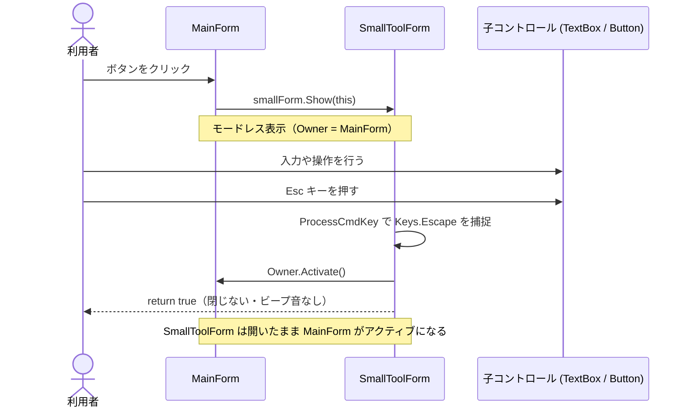

# C# WinForms：小さいFormを閉じずに Esc キーでメインFormへフォーカスを移す

## 背景と課題

WinForms アプリで次のような画面操作を作りたいとする。

1. メインの `Form` にあるボタンを押すと、小さい `Form` が新しく表示される。
2. 小さい `Form` で作業したあと、**Esc キーを押したら小さい `Form` は閉じずに、メインの `Form` にフォーカスを移したい**。

ところが、普通に試してみると次のような壁にぶつかりやすい。

- `ShowDialog()` で開いていると、そもそもメイン `Form` にフォーカスが移らない。
- 小さい `Form` の `KeyDown` イベントに書いても、`TextBox` や `Button` にフォーカスがあると反応しない。
- `mainForm.Focus()` を呼んでも別の `Form` にフォーカスが移らない。
- Esc キーを押したときに Windows の警告音（ビープ音）が鳴ったり、小さい `Form` 自体が閉じてしまったりする。

## 結論

**小さい `Form` をモードレス（`Show(this)`）で開き、小さい `Form` 側で `ProcessCmdKey` をオーバーライドして `Keys.Escape` を捕捉し、`this.Owner?.Activate()` を呼ぶ。**

押さえるべきポイントは 4 つだけである。

1. `ShowDialog()` ではなく **`Show(this)`（または `Show()`）** で開く。
2. `KeyDown` ではなく **`ProcessCmdKey`** で `Keys.Escape` を拾い、`return true;` で処理を完結させる。
3. フォーカス移動には `Focus()` ではなく **`Activate()`** を使う。
4. 小さい `Form` の **`CancelButton` プロパティは未設定（`null`）** のままにする。

---

## 処理の流れ



---

## なぜうまくいかない実装があるのか

### 1. `ShowDialog()` だと閉じない限りメインへ戻れない
`ShowDialog()` はモーダルダイアログとして表示するため、Windows の仕様上、小さい `Form` を閉じるまでメイン `Form` への入力やフォーカス移動がブロックされる。「小さい `Form` を開いたままメイン `Form` にフォーカスを移す」要件では、必ず **`Show(this)`** または **`Show()`** を使う必要がある。

### 2. `Form.KeyDown` は子コントロールに吸われる
フォーム上に `TextBox` や `Button` があると、キー入力はフォーカスを持っている子コントロールに渡される。フォームの `KeyDown` で受け取るには `this.KeyPreview = true;` を設定したうえで `e.SuppressKeyPress = true;` でビープ音を抑える必要がある。

一方、**`ProcessCmdKey` のオーバーライド** は子コントロールより先にコマンドキーを検査できるため、`KeyPreview = true` の設定漏れがなく、`return true;` だけでビープ音や既定動作も抑止できる。

### 3. `Form.Focus()` ではなく `Form.Activate()` を使う
`Control.Focus()` は「すでにアクティブなウィンドウの中にあるコントロール」にフォーカスを移すためのメソッドであり、別ウィンドウ（別 `Form`）を前面に出して入力フォーカスを与えるには **`Form.Activate()`** を使う。

---

## C# の実装例（最小構成）

### 1. メイン Form 側

ボタンが押されたとき、`Show(this)` で小さい `Form` を開く。ボタンを押すたびに何重にも開きたくない場合は、フィールドで開いているインスタンスを保持しておく。

```csharp
public partial class MainForm : Form
{
    private SmallToolForm? _smallForm;

    public MainForm()
    {
        InitializeComponent();
    }

    private void ButtonOpenSmallForm_Click(object? sender, EventArgs e)
    {
        if (_smallForm is { IsDisposed: false })
        {
            _smallForm.Activate();
            return;
        }

        _smallForm = new SmallToolForm();
        _smallForm.FormClosed += (_, _) => _smallForm = null;
        _smallForm.Show(this); // ShowDialog() ではなく Show(this) を使う
    }
}
```

### 2. 小さい Form 側

`ProcessCmdKey` をオーバーライドし、`Keys.Escape` のときに `Owner?.Activate()` を呼ぶ。`Close()` は呼ばず、`return true;` を返す。

```csharp
public partial class SmallToolForm : Form
{
    public SmallToolForm()
    {
        InitializeComponent();
    }

    protected override bool ProcessCmdKey(ref Message msg, Keys keyData)
    {
        if (keyData == Keys.Escape)
        {
            // 小さいFormは閉じず、メインForm（Owner）をアクティブにする
            Owner?.Activate();
            return true;
        }

        return base.ProcessCmdKey(ref msg, keyData);
    }
}
```

---

## 実務で調整しやすいポイント

### `Show(this)` と `Show()` のどちらを選ぶか（Z オーダーの違い）

| 呼び出し方 | `Owner` | Esc 後の見え方 |
| --- | --- | --- |
| `smallForm.Show(this)` | メイン `Form` | メイン `Form` にフォーカスが移っても、小さい `Form` は**常にメイン `Form` より手前に残る**（検索窓やツールパレット向き） |
| `smallForm.Show()` | `null` | メイン `Form` にフォーカスが移ると、メイン `Form` が前面に出て小さい `Form` は**後ろに隠れる** |

`Show()`（引数なし）を使う場合は `Owner` が `null` になるため、コンストラクタ等でメイン `Form` の参照を受け取っておき、`(Owner ?? _returnTarget)?.Activate()` のように呼び出す。

### メイン Form 内の「特定の入力欄」にフォーカスを当てたい場合
`mainForm.Activate()` だけを呼ぶと、メイン `Form` の中で直前にフォーカスがあったコントロールにカーソルが戻る。もし「Esc で戻ったら必ず特定の `TextBox` に入力できるようにしたい」という場合は、メイン `Form` 側に公開メソッドを用意して `Activate()` のあとに `textBox.Focus()` を呼ぶ。

```csharp
public void ActivateAndFocusInput()
{
    Activate();
    textBoxMainInput.Focus();
}
```

### `CancelButton` プロパティに注意する
デザイナーで小さい `Form` の `CancelButton` に「閉じる」ボタン等を設定していると、Esc キーでフォームを閉じる動作と意図が競合する。閉じずにメインへフォーカスを戻したい場合は、`CancelButton` は未設定（`(なし)`）のままにしておく。

---

## 動かせるサンプルコードとドキュメント

リポジトリ内に Visual Studio でそのまま開いて動かせる完全なサンプル一式を用意している。

- サンプルの概要と動かし方: [samples/WinFormsEscFocusReturn/README.md](../samples/WinFormsEscFocusReturn/README.md)
- 設計とシーケンス図: [samples/WinFormsEscFocusReturn/docs/architecture.md](../samples/WinFormsEscFocusReturn/docs/architecture.md)
- 手動テスト手順・SmokeTests: [samples/WinFormsEscFocusReturn/docs/manual-test-cases.md](../samples/WinFormsEscFocusReturn/docs/manual-test-cases.md)
- 実装ソース: [MainForm.cs](../samples/WinFormsEscFocusReturn/WinFormsEscFocusReturn/Forms/MainForm.cs) / [SmallToolForm.cs](../samples/WinFormsEscFocusReturn/WinFormsEscFocusReturn/Forms/SmallToolForm.cs)
