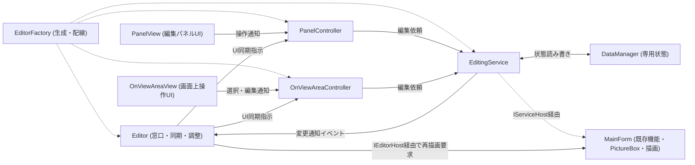
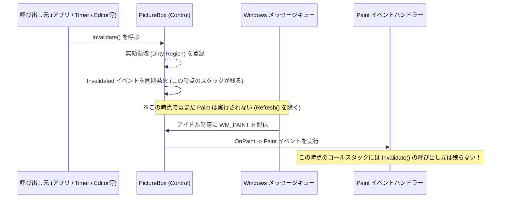
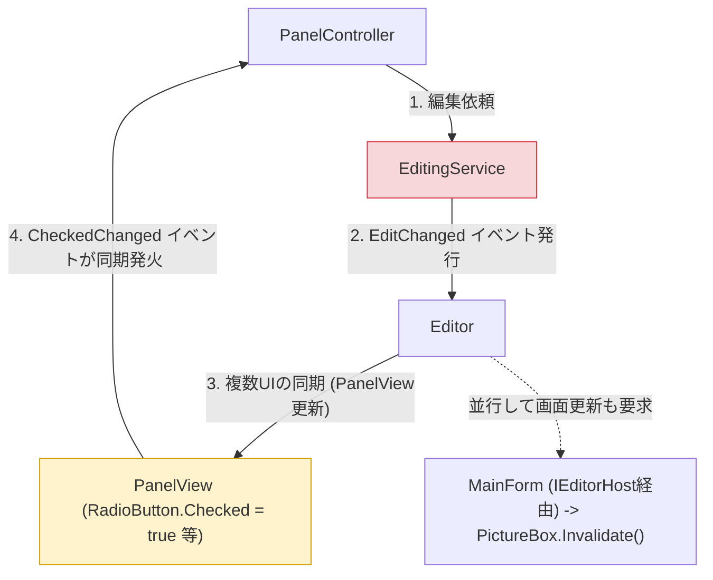
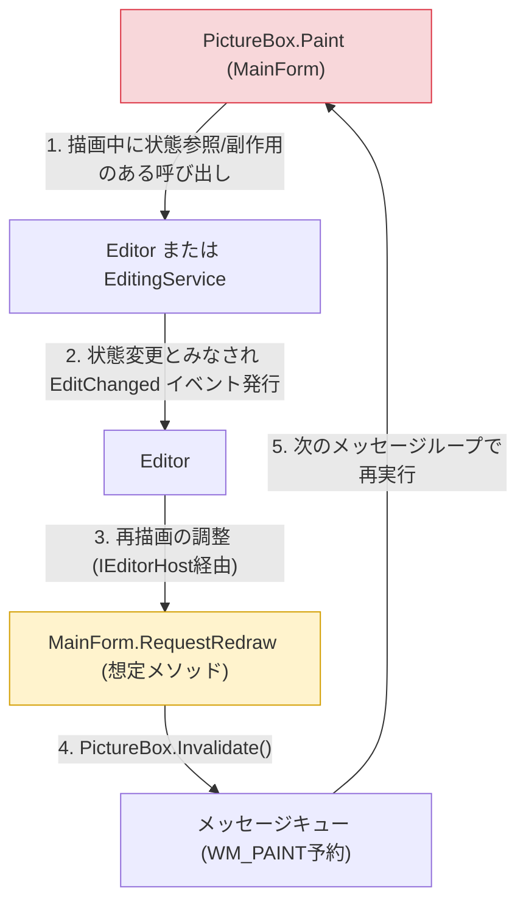
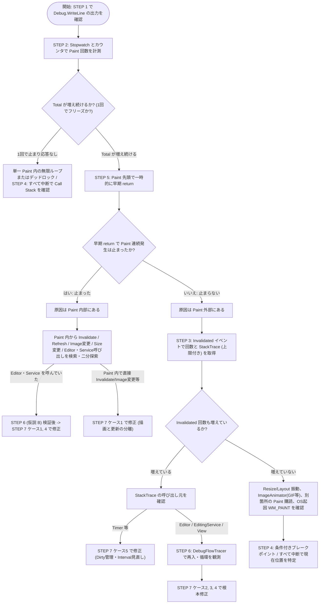

# WinForms `PictureBox.Paint` 連続発生問題のデバッグ手順書

## 0. はじめに（前提とドキュメントの読み方）

本手順書は、**C# / Windows Forms / Visual Studio 2019** で開発されているデスクトップアプリケーションにおいて、`PictureBox` の `Paint` イベントハンドラーが異常な頻度で連続実行される問題を、**推測ではなく観測事実に基づいて段階的に切り分け、原因を特定・修正するための実践ガイド**です。

> [!IMPORTANT]
> **実プロジェクトコードの確認状況と本手順書の扱い**
> 本ドキュメントの作成時点で参照したリポジトリ内には、対象システム（`MainForm`、`EditorFactory`、`Editor`、`EditingService`、`DataManager`、`PanelController`、`PanelView`、`OnViewAreaController`、`OnViewAreaView`、`IEditorHost`、`IServiceHost`、および問題の `PictureBox` を持つ既存コード）のソースファイルは含まれていません。
> そのため、本書内の C# コード例およびメソッド名（例：`RequestRedraw`、`EditChanged` など）は**汎用的な実装パターンおよび調査用コード例**として記載しています。実作業では、各セクションの**「実際のプロジェクトで確認すべき箇所」**を参照し、実際のクラス名・イベント名・メソッド名に読み替えて適用してください。

> [!NOTE]
> **仮説と確認済み事実の区別**
> 現象の発生初期段階では「イベント循環が起きている」「`Paint` の中で `Invalidate` している」などの推測をしがちですが、原因を決めつけると調査が遠回りになります。本書では、**観測された事実（ログ・コールスタック・計測値）**と**検証対象の仮説**を明確に区別して進めます。

---

## 1. 背景と基礎知識

### 1.1 システム構成の整理

対象システムは、既存の巨大な `MainForm` に対して、新規の編集機能を分離・接続する構成をとっています。



この構成において、各コンポーネントの役割は次のとおりです。

| コンポーネント | 想定される責務（背景情報より） | 調査上の着眼点 |
| --- | --- | --- |
| `MainForm` | 既存機能、`PictureBox`、アノテーション描画・編集を管理 | `Paint` ハンドラー本体、`Invalidate`/`Refresh`/`Update` 呼び出し、既存タイマーやレイアウト変更 |
| `EditorFactory` | 編集関連オブジェクトの生成と依存関係の接続 | イベント購読（`+=`）の二重登録や意図しない循環配線の有無 |
| `Editor` | 編集機能の窓口、複数 UI の同期、画面更新の調整 | 通知受信後の UI 同期処理、再描画要求（`IEditorHost` 経由）の頻度と条件 |
| `EditingService` | Paste、Copy、Delete、Undo などの編集処理、変更確定後のイベント発行 | 状態変化がない場合の発火有無、再入時の挙動 |
| `DataManager` | 編集機能専用の状態管理 | 状態の同値判定や変更通知の粒度 |
| `PanelController` / `PanelView` | 編集パネルの操作・表示 | ラジオボタン等の `CheckedChanged` などがコードによる値変更でも発火するか |
| `OnViewAreaController` / `OnViewAreaView` | 画面上での選択・編集操作 | マウス移動・描画連動・選択変更に伴う再描画要求の有無 |
| `IEditorHost` / `IServiceHost` | `MainForm` の機能を限定的に公開するインターフェース | 再描画要求メソッドの実装先が `Invalidate` / `Refresh` / `Update` のどれか |

---

### 1.2 `PictureBox.Paint` イベントはどのような条件で発生するのか？

WinForms（Windows Forms）における `Control.Paint`（`PictureBox.Paint` も継承元 `Control` の仕組みを利用）は、主に次の契機で発生します。

1. **アプリコードからの明示的な無効化・再描画要求**
   - `pictureBox.Invalidate()`（または領域指定の `Invalidate(Rectangle)`）が呼ばれ、コントロールのクライアント領域が「描画が必要（無効領域）」とマークされた後、メッセージループで `WM_PAINT` が処理されたとき。
   - `pictureBox.Refresh()` が呼ばれたとき（内部的に子コントロールを含めて無効化し、即座に再描画を実行します）。
   - `pictureBox.Update()` が呼ばれたとき（**すでに無効領域が存在する場合のみ**、メッセージキューの待機を待たず同期的に `WM_PAINT` を処理します）。
2. **`PictureBox` 固有のプロパティやレイアウトの変化**
   - `Image`、`ImageLocation`、`SizeMode`、`BackgroundImage` などの変更。
   - `Size`、`Location`、`Dock`、`Anchor`、親コンテナ（`Panel` や `SplitContainer` 等）のサイズ変更やスクロール。
3. **OS（Windows デスクトップウィンドウマネージャー / GDI）からの再描画要求**
   - ウィンドウの最小化からの復元、他ウィンドウやダイアログが上に重なった後の露出、移動、DPI 変更、テーマ変更など。
4. **親コントロールや隣接コントロールの再描画連鎖**
   - 透過背景風の描画や親コントロールの更新に伴って子コントロールに再描画が波及するケース。

---

### 1.3 「`Paint` の連続実行」と「単一 `Paint` 処理内の無限ループ」の違い

現象を観察するとき、まずこの 2 つを混同しないことが重要です。

| 観点 | `Paint` の連続実行（今回の想定現象） | 単一 `Paint` 処理内の無限ループ |
| --- | --- | --- |
| **何が起きているか** | `Paint` ハンドラー自体は毎回最後まで `return` して終わるが、すぐ次の描画要求が来て何度も呼ばれる | 1 回の `Paint` ハンドラー内の `for` / `while` / 再帰から抜けられない |
| **UI の応答性** | 他の UI 操作が「重い・カクつく」ことはあるが、メッセージループが回るため完全に固まらない場合がある（ただし CPU 100% 近くになると応答不能に見えることもある） | メッセージループに一切戻らないため、ウィンドウが完全にフリーズ（「応答なし」）する |
| **Call Stack の見え方** | 中断（Break All）すると、`Paint` が浅い位置にあり、呼び出し元に `WndProc` / メッセージループ（`Application.Run`）が見える | 中断すると、同じ `Paint` 内のループ行で止まり続ける（または再帰ならスタックが極端に深くなり `StackOverflowException` に至る） |
| **出力ログの出方** | `Paint` の開始ログ・終了ログが対になって大量に出力され続ける | 開始ログが 1 回だけ出て、終了ログが出ない（ループ内にログがあればそれだけが出る） |

---

### 1.4 想定している 2 つの原因の方向性

現時点では、以下のどちら（または複合）であるかを観測で切り分けます。

1. **仮説群 1（Paint 内部起因）**：`Paint` イベント内部、または `Paint` から呼び出す描画・補助処理が、直接または間接的に再描画（`Invalidate` / `Refresh` / プロパティ変更など）を要求している。
2. **仮説群 2（Paint 外部起因）**：`Paint` の外にある `Timer`、マウス/UI イベント、`EditingService` の変更通知、`Editor` の同期処理などが繰り返し発生し、結果として `Paint` が高頻度で呼び出されている。

---

## STEP 1：ログ出力環境の準備（Visual Studio 2019）

まず、コードの実行回数や経路をUI操作を止めずに観測できるよう、Visual Studio 2019 で `Debug.WriteLine` のログを確認できる環境を整えます。

### 操作

1. Visual Studio 2019 上部のツールバーで、ソリューション構成が **`Debug`** になっていることを確認します（`Release` になっていれば `Debug` に切り替えます）。
2. メニューから **［表示］→［出力］**（ショートカット：`Ctrl + Alt + O` 等、環境設定による）をクリックし、**出力**ウィンドウを表示します。
3. 出力ウィンドウ上部のドロップダウン **「出力元の表示」** を **`デバッグ`** に変更します。
4. 動作確認のため、調査対象フォーム（例：`MainForm` のコンストラクタや `Load` イベントなど、起動時に 1 回だけ通る場所）に一時的な確認コードを追加し、**`F5`** キーでデバッグ実行します。

```csharp
// 先頭に using を追加するか、完全修飾名で呼び出します。
using System.Diagnostics;

// 例：MainForm_Load など起動時に1回だけ呼ばれる箇所に一時追記
private void MainForm_Load(object sender, EventArgs e)
{
    // Debug.WriteLine は DEBUG シンボルが定義されたビルド（通常は Debug 構成）でのみ有効になります。
    // Release ビルドではコンパイラによって呼び出し自体が除外されます。
    Debug.WriteLine($"[DEBUG-CHECK] MainForm_Load 実行時刻: {DateTime.Now:HH:mm:ss.fff}");

    // 以下、既存の初期化処理...
}
```

#### `Debug.WriteLine` が表示されない場合の確認事項

出力ウィンドウに何も表示されない場合は、次の項目を上から順に確認してください。

1. **ビルド構成が `Debug` か**
   - `Release` 構成では、`DEBUG` 条件付きコンパイルシンボルが定義されていないことが一般的であり、`[Conditional("DEBUG")]` が付いた `Debug.WriteLine` はビルド時に除去されます。
   - プロジェクトのプロパティ →［ビルド］タブで、現在の構成（`Debug`）に **「DEBUG 定数の定義」** チェックが入っているかも確認してください。
2. **「出力元の表示」が `デバッグ` になっているか**
   - 「ビルド」や「ソース管理」など別の出力元が選択されていると、デバッグ出力は見えません。
3. **「イミディエイト ウィンドウ」にリダイレクトされていないか**
   - Visual Studio 2019 のメニュー **［ツール］→［オプション］→［デバッグ］→［全般］** にある **「すべての出力ウィンドウのテキストをイミディエイト ウィンドウにリダイレクトする」** にチェックが入っていると、出力ウィンドウではなくイミディエイト ウィンドウに表示されます（確認したい場所に合わせて設定するか、［デバッグ］→［ウィンドウ］→［イミディエイト］を確認してください）。
4. **`F5`（デバッグ開始）で実行しているか**
   - `Ctrl + F5`（デバッグなしで開始）ではデバッガーがアタッチされないため、Visual Studio の出力ウィンドウには表示されません。
5. **起動しているスタートアッププロジェクトが正しいか**
   - ソリューションに複数プロジェクトがある場合、調査コードを書いたプロジェクトとは別の実行ファイルが起動していないか確認してください。
6. **補足：`Trace.WriteLine` との違い**
   - `Debug.WriteLine` は主に `DEBUG` 構成用、`Trace.WriteLine` は `TRACE` シンボル定義時（多くの場合 `Debug` / `Release` 両方）に有効です。調査が終わった後に消し忘れたときの影響を抑える目的でも、一時調査は `Debug.WriteLine` を使う方が安全です。

### 期待される結果

- 出力ウィンドウ（出力元：`デバッグ`）に `[DEBUG-CHECK] MainForm_Load 実行時刻: ...` という行が 1 行表示される。

### 結果から分かること

- Visual Studio 2019 のデバッグログ出力経路が正常に機能しており、以降のステップで数値計測やコールスタック出力を観測できる状態であることが確認できます。

### 次の調査先

- ログ出力が確認できたら、**STEP 2** に進み、`PictureBox.Paint` の実際の発生頻度・回数を定量的に計測します。

---

## STEP 2：`Paint` の発生回数を計測する

`Paint` が「速く何度も起きている」のか、あるいは「1 回だけ非常に重く、ログが大量に出て見えているだけ」なのかを数値で確認します。毎回の `Paint` で無条件に `Debug.WriteLine` を呼ぶと、出力ウィンドウへの描画コスト自体がアプリを極端に遅くしたり、現象のタイミングを変えたりするため、**一定回数ごと（間引き）＋ `Stopwatch` による時間計測**を使います。

### 実際のプロジェクトで確認すべき箇所

- `MainForm`（またはカスタムコントロール）で `PictureBox.Paint` に登録されているイベントハンドラー（デザイナーの `InitializeComponent()` 内で `+= new PaintEventHandler(...)` されている箇所、またはコード上で購読している箇所）。
- もし `PictureBox` を継承した独自クラスで `OnPaint(PaintEventArgs e)` をオーバーライドしている場合は、そのメソッドも対象です。

### サンプルコード（汎用的な計測用スニペット）

```csharp
using System;
using System.Diagnostics;
using System.Windows.Forms;

public partial class MainForm : Form
{
    // --- STEP 2 調査用フィールド（調査完了後に必ず削除する） ---
    // Paint イベントが合計何回呼ばれたかを記録するカウンタ
    private long _debugPaintTotalCount = 0;

    // 前回の計測区間から何回呼ばれたかを記録するカウンタ
    private long _debugPaintWindowCount = 0;

    // 経過時間を高精度に計測するための Stopwatch
    private readonly Stopwatch _debugPaintStopwatch = Stopwatch.StartNew();

    // ログ出力を間引く間隔（例：100回ごと、または1000ミリ秒ごと）
    private const int DebugPaintLogIntervalCount = 100;
    private const long DebugPaintLogIntervalMs = 1000;
    // -------------------------------------------------------------

    private void pictureBoxMain_Paint(object sender, PaintEventArgs e)
    {
        // 【1】開始時点でカウントアップ
        _debugPaintTotalCount++;
        _debugPaintWindowCount++;

        long elapsedMs = _debugPaintStopwatch.ElapsedMilliseconds;

        // 【2】「一定回数に達した」または「1秒経過した」ときだけログ出力する
        // 毎回 Debug.WriteLine を呼ぶと I/O 負荷で現象が歪むため、必ず間引く
        if (_debugPaintWindowCount >= DebugPaintLogIntervalCount || elapsedMs >= DebugPaintLogIntervalMs)
        {
            // 1秒あたりの発生回数（Paint/sec）の概算を算出（ゼロ除算防止）
            double paintsPerSec = elapsedMs > 0
                ? (_debugPaintWindowCount * 1000.0) / elapsedMs
                : _debugPaintWindowCount;

            Debug.WriteLine(
                $"[PAINT-METER] Total={_debugPaintTotalCount}, " +
                $"WindowCount={_debugPaintWindowCount}, " +
                $"Elapsed={elapsedMs}ms, " +
                $"Rate={paintsPerSec:F1} paints/sec");

            // 区間カウンタとストップウォッチをリセットして次の計測へ
            _debugPaintWindowCount = 0;
            _debugPaintStopwatch.Restart();
        }

        // 【3】ここから既存の描画処理...
    }
}
```

> [!TIP]
> もし `Paint` が 1 秒間に数回程度しか起きていない場合（`DebugPaintLogIntervalCount = 100` に達しない場合）でも、`elapsedMs >= DebugPaintLogIntervalMs` の条件により 1 秒ごとに出力されるため状況を見逃しません。逆に 1 秒間に何千回も起きている場合は 100 回ごとに出力されます。環境に応じて `100` を `500` や `1000` に調整してください。

### 操作

1. 実プロジェクトで `PictureBox.Paint` を処理しているメソッドの先頭に、上記の計測コード（フィールドとカウント処理）を一時的に組み込みます。
2. `Debug` 構成で `F5` 実行し、問題が再現する画面・状態まで操作します。
3. 操作を一切せずマウスも動かさない状態で、10 秒ほど出力ウィンドウ（デバッグ）のログ増え方を観察します。

### 期待される結果

- 正常な状態であれば、マウスやキーボード操作を止めると `Rate` は `0` に近い値に落ち着き、ログ出力は止まるか 1 秒に 0〜1 回未満になります。
- 問題が発生している場合、操作を止めていても `[PAINT-METER]` が連続出力され続け、`Total` が急増します（例：`Rate=60.0 paints/sec` 以上、あるいは数百〜数千 `paints/sec`）。

### 結果から分かること

- **「1 回の `Paint` が途中で無限ループして止まっている」のか、「`Paint` が最後まで完了して何度も再実行されている」のか**が確定します。
  - `[PAINT-METER]` の `Total` が増え続けるなら、**`Paint` が毎回最後まで抜けて繰り返し実行されている（連続実行）**という確認済み事実になります。
  - 逆に `Total=1` で止まったまま UI が応答なしになるなら、**単一 `Paint` 内の無限ループ**（またはデッドロック）です。
- 画面操作を止めても増え続けるか、特定の操作後だけ増えるかによって、定常的なタイマー/循環か、特定トリガー起点かの見当がつきます。

### 次の調査先

- `Paint` が連続実行されていることが確認できたら、**STEP 3** に進み、「そもそもアプリ側から `Invalidate()` が呼ばれているのか」を `Invalidated` イベントで観測します。
- 単一 `Paint` 内で止まっていることが分かった場合は、**STEP 4** の「すべて中断（Break All）」へ直接進みます。

---

## STEP 3：`Invalidated` イベントの調査

`Paint` が連続実行されているとき、次に知りたいのは**「誰が再描画を要求しているのか」**です。その第一歩として、`PictureBox.Invalidated` イベントを一時的に購読し、スタックトレースを採取します。

### 3.1 `Invalidate` と `Invalidated`、`Paint` の関係と違い



- **`Invalidate()` と `Invalidated` の関係**
  - コントロールの `Invalidate()` が呼ばれ、再描画が必要（無効）とマークされたタイミングで `Invalidated` イベントが発生します（WinForms の標準的な挙動として、無効化メソッドの呼び出しと同期してイベントが発火します）。
- **`Invalidated` と `Paint` の違い**
  - `Invalidated` は「再描画が必要になった（無効化された）**瞬間**」に同期的に呼ばれます。
  - `Paint` はその後、メッセージループが `WM_PAINT` を処理するタイミング（非同期・遅延、複数の `Invalidate` が 1 回にまとまることもある）で呼ばれます。そのため、**`Paint` ハンドラー内でコールスタックを見ても、`Invalidate()` を呼んだ犯人はすでにスタックから消えている**のが普通です。だからこそ `Invalidated` 側でスタックを取る価値があります。
- **`Invalidated` が発生しなくても `Paint` が発生し得る理由**
  - OS 側が直接 `WM_PAINT` を発生させる場合（ウィンドウが隠れて再露出、ウィンドウ移動、デスクトップ合成/DPI 関連、OS レベルのネイティブ無効化など）、マネージコード側の `Control.Invalidate()` を経由しないため、`Invalidated` イベントが発火せずに `Paint` だけが呼ばれることがあります。
  - また、`Control` の内部スタイルや親コントロール・システム側のウィンドウメッセージ処理によっては、アプリコードが明示的に `Invalidate()` を呼んだ場合とは異なる経路で `WM_PAINT` が送られる場合があります。
- **`Invalidated` の呼び出し履歴から原因を特定できる場合とできない場合**
  - **特定できる場合**：アプリケーション内の誰か（`MainForm`、`Editor`、`Timer`、`Paint` 自身など）が `pictureBox.Invalidate()` や `Refresh()` を呼んでいる場合。スタックトレースにそのメソッド名が出現します。
  - **特定できない（または分かりにくい）場合**：
    1. `Invalidated` 自体が増えていないのに `Paint` だけが増えている（OS 起因の `WM_PAINT` や、ネイティブウィンドウ処理・サイズ再計算など）。
    2. `Invalidated` は起きているが、スタックトレースを見ると `Control.SetBoundsCore` や `PictureBox.set_Image` など WinForms のプロパティ変更経由になっている（さらにその変更を誰が呼んでいるかを見る必要がある）。
    3. 非同期コールバックや `BeginInvoke` / `Timer` が毎回別のターンで `Invalidate()` を呼んでいるため、1 回のスタックだけでは「ループの全体像」までは見えない（その場合はイベント発行元のログと組み合わせる）。

### 3.2 スタックトレース取得の負荷への配慮

`new StackTrace(true)`（ファイル名と行番号を取得するモード）は、PDB シンボルの解析を行うため**非常に重い処理**です。`Invalidated` が毎秒何百回も発火している状況で無制限に `new StackTrace(true)` を実行すると、Visual Studio ごと固まったように見えることがあります。

必ず以下の安全策を入れてください。

- **出力上限回数**（例：最初の 10 回だけ出力して止める）を設ける。
- **時間または回数の間引き**を入れる。
- まずは `fNeedFileInfo: false` で軽量に試し、メソッド名だけで足りなければ必要な数回だけ `true` にする。

### サンプルコード（汎用的な `Invalidated` 調査コード）

```csharp
using System;
using System.Diagnostics;
using System.Windows.Forms;

public partial class MainForm : Form
{
    // --- STEP 3 調査用フィールド（調査完了後に必ず削除する） ---
    private long _debugInvalidatedCount = 0;
    private int _debugStackTracePrintedCount = 0;

    // スタックトレースは非常に重いため、最大出力回数を制限する
    private const int MaxStackTraceLogs = 10;
    // -------------------------------------------------------------

    // 初期化時（MainForm_Load 等）に一時的にイベント購読を登録する
    private void AttachDebugInvalidatedLogger()
    {
        // 既存の登録がない箇所で1回だけ購読する
        pictureBoxMain.Invalidated += PictureBoxMain_DebugInvalidated;
    }

    private void DetachDebugInvalidatedLogger()
    {
        pictureBoxMain.Invalidated -= PictureBoxMain_DebugInvalidated;
    }

    private void PictureBoxMain_DebugInvalidated(object sender, InvalidateEventArgs e)
    {
        _debugInvalidatedCount++;

        // 上限回数に達するまでだけスタックトレースを出力する（負荷対策）
        if (_debugStackTracePrintedCount < MaxStackTraceLogs)
        {
            _debugStackTracePrintedCount++;

            // skipFrames: 1 でこのメソッド自身をスキップ
            // fNeedFileInfo: true で行番号も取得（重いので MaxStackTraceLogs で必ず制限する）
            var st = new StackTrace(skipFrames: 1, fNeedFileInfo: true);

            Debug.WriteLine(
                $"=== [INVALIDATED #{_debugInvalidatedCount}] Region={e.InvalidRect} ===");
            Debug.WriteLine(st.ToString());
        }
        else if (_debugInvalidatedCount % 200 == 0)
        {
            // 上限後は回数だけ間引き出力して負荷を抑える
            Debug.WriteLine($"[INVALIDATED] TotalCount={_debugInvalidatedCount}");
        }
    }
}
```

### 操作

1. `MainForm` の初期化処理（`Load` やコンストラクタの `InitializeComponent()` の後）に `AttachDebugInvalidatedLogger()` を一時的に追加します。
2. フォームを閉じるとき（`FormClosed` 等）に `DetachDebugInvalidatedLogger()` を呼ぶようにしておきます。
3. `Debug` 構成で `F5` 実行し、問題が発生する状況を作って出力ウィンドウを確認します。

### 期待される結果

次のいずれかのパターンが観測されます。

- **パターン A**：`[INVALIDATED #1] ...` から `#10` までが連続で出力され、スタックトレースにアプリ側のメソッド（例：`MainForm.RequestRedraw`、`pictureBoxMain_Paint`、`timer1_Tick`、`PictureBox.set_Image` など）が記録される。
- **パターン B**：STEP 2 の `[PAINT-METER]` は増え続けているのに、`[INVALIDATED]` の回数が増えない（または初期の数回だけで止まっている）。

### 結果から分かること

- **パターン A の場合**：アプリコードまたは WinForms プロパティ変更を経由して**明示的または間接的に無効化が呼ばれている**ことが確定します。スタックトレースに出たメソッド名がそのまま次の調査ターゲットになります。
  - スタックトレースの中に `Paint` ハンドラー自身が含まれていれば、**「`Paint` 内部起因（STEP 5 へ）」**が濃厚です。
  - スタックトレースの中に `Editor` / `EditingService` / `PanelController` / `Timer` が含まれていれば、**「外部起因またはイベント循環（STEP 5・STEP 6 へ）」**が濃厚です。
- **パターン B の場合**：アプリ側の `Invalidate()` 呼び出しではなく、**OS からの `WM_PAINT` 再送やネイティブレベル・特殊な描画ループ**などが疑われます（STEP 4 のデバッガー中断および STEP 5 で描画処理の切り分けを行います）。

### 次の調査先

- スタックトレースに出た疑わしいメソッドや、パターン B の現在位置をリアルタイムで詳しく調べるために、**STEP 4（Visual Studio のデバッガー操作）**に進みます。

---

## STEP 4：Visual Studio 2019 のデバッガー操作

ログだけでは「その瞬間の変数の値」「ループを何回まわっているか」「今まさにどのコードを実行中か」が見えにくいことがあります。Visual Studio 2019 のデバッガーを使って正確に状態を掴みます。

### 4.1 基本と条件付きブレークポイント・ヒットカウント

#### 1. 通常のブレークポイント
- **操作**：コードエディタの左端（灰色の余白）をクリックするか、対象行にカーソルを置いて **`F9`** キーを押します。赤い丸が付きます。
- **使いどころ**：まず 1 回だけ確実に通ることを確認したいとき。ただし、連続発生中の `Paint` にそのまま置くと、実行するたびに毎回止まって操作できなくなります。

#### 2. 条件付きブレークポイント（連続発生時に必須）
- **操作**：
  1. 赤いブレークポイントの上で右クリック → **［条件...］** を選択します（またはホバー時に出る歯車アイコンをクリック）。
  2. 「条件」にチェックを入れ、たとえば `_debugPaintTotalCount > 50` や `this.IsHandleCreated` などの式を入力します。
  3. あるいは「アクション」を使うと、停止せずに任意の文字列（例：`Paint called, count={_debugPaintTotalCount}`）を出力ウィンドウへ出す「トレースポイント」としても使えます。

#### 3. ヒットカウント（何回目で止めるか指定）
- **操作**：
  1. ブレークポイントの右クリック → **［条件...］** を開きます。
  2. ドロップダウンから「条件式」ではなく **「ヒット カウント」** を選択します。
  3. 「次の値と等しい」（例：`100`）や「次の値の倍数」（例：`50`）を指定します。
- **使いどころ**：起動直後の正常な数回の `Paint` を素通りさせ、「100 回目の `Paint` に入った瞬間」だけを捕まえたいときに有効です。

---

### 4.2 すべて中断（Break All）と呼び出し履歴（Call Stack）

現象が暴走している最中に「今まさに動いている処理」を捕まえる操作です。

- **操作**：
  1. `F5` で実行し、`Paint` が連続発生している状態にします。
  2. Visual Studio 2019 のメニューから **［デバッグ］→［すべて中断］** をクリックします（標準の全般設定ではショートカット `Ctrl + Alt + Break` ですが、ノート PC 等で `Break` キーがない場合はメニューから実行するのが確実です）。
  3. 中断されたら、**［デバッグ］→［ウィンドウ］→［呼び出し履歴］** を開きます。
- **確認のポイント**：
  - 呼び出し履歴ウィンドウ内で右クリックし、必要に応じて **［外部コードの表示］** をオンにすると、`System.Windows.Forms.dll` 内のフレーム（`Control.PaintWithErrorHandling` や `Application.ThreadContext.RunMessageLoop` など）も表示されます。
  - **1 回だけ中断しても偶然別の処理で止まることがある**ため、何度か「続行（`F5`）→ すぐ［すべて中断］」を繰り返し、毎回 `Paint` 付近で止まるか、あるいはどんな別処理が見えているかを確認します。

---

### 4.3 ステップイン（`F11`）とステップアウト（`Shift + F11`）

- **ステップイン（`F11`）**
  - 現在行が呼び出しているメソッドの**内部**に入ります。
  - 例：`Paint` の中で `_host.NotifySomething()` や描画ヘルパーを呼んでいるとき、その内部で `Invalidate()` や状態変更をしていないか 1 階層ずつ潜って確認します。
- **ステップアウト（`Shift + F11`）**
  - 現在のメソッドの残りを最後まで実行し、**呼び出し元に戻った直後**で止めます。
  - 例：意図せず深いメソッドに入ってしまったときや、`Paint` の実行が終わった直後にどこへ制御が戻るのかを追いたいときに使います。

---

### 4.4 フレームワーク内部に関数ブレークポイントを置く場合の制約と設定

「アプリ内のどこから `Control.Invalidate` が呼ばれているか、ソースコードを変更せずに調べたい」という場合、Visual Studio の**関数ブレークポイント**（［デバッグ］→［新しいブレークポイント］→［関数のブレークポイント］で `System.Windows.Forms.Control.Invalidate` 等を指定）を使う方法があります。しかし、Visual Studio 2019 ではデフォルト設定のままだと機能しないことがあるため、以下の制約を理解しておく必要があります。

1. **「マイ コードのみ（Just My Code）」による制約**
   - デフォルトでは［マイ コードのみ］が有効になっており、ユーザーコード以外のフレームワーク内部（`System.Windows.Forms.dll`）にはブレークポイントが張れない・ステップインできない・呼び出し履歴で `[外部コード]` として折りたたまれることがあります。
   - **設定変更場所**：**［ツール］→［オプション］→［デバッグ］→［全般］** にある **「マイ コードのみを有効にする」** のチェックを一時的に外します。
2. **シンボル（PDB）の読み込みが必要**
   - フレームワーク内部の関数名でブレークポイントを解決するには、Microsoft のシンボルファイルが必要です。
   - **設定変更場所**：**［ツール］→［オプション］→［デバッグ］→［シンボル］** で **「Microsoft シンボル サーバー」** にチェックを入れます（初回実行時はシンボルダウンロードのため起動や中断に数十秒〜数分かかる場合があります）。
   - ※社内ネットワークのプロキシやオフライン環境ではシンボルサーバーに接続できず、関数ブレークポイントが張れない（白抜きの丸になり「シンボルが読み込まれていません」と表示される）場合があります。その場合は、無理に関数ブレークポイントに頼らず、**STEP 3 の `Invalidated` イベント購読**や **STEP 5 のソースコード側切り分け**を優先してください。
3. **オーバーロードによる複数一致**
   - `Control.Invalidate` には引数なし・`Rectangle` 付き・`bool` 付きなど複数のオーバーロードが存在します。関数名だけで指定すると複数箇所にブレークポイントが設定される場合がある点にも注意してください。

### 操作（STEP 4 のまとめ手順）

1. `Paint` ハンドラーの先頭に条件付きブレークポイント（またはヒットカウント `50` 等）を設定して `F5` 実行し、止まったときの**［呼び出し履歴］**を確認します。
2. もし連続発生中にアプリが重い場合は、ブレークポイントなしで実行中に **［デバッグ］→［すべて中断］** を 3 回ほど試み、毎回どこで止まるか呼び出し履歴を見比べます。
3. `Paint` 内の怪しいメソッド呼び出しがあれば **`F11`（ステップイン）** で中身を確認し、抜けるときは **`Shift + F11`（ステップアウト）** を使います。

### 期待される結果

- 呼び出し履歴ウィンドウに、停止時点のコールスタック（アプリ側メソッドおよび必要に応じて `[外部コード]`）が表示されます。

### 結果から分かること

- `Paint` 実行中に、内部のどのメソッドが呼ばれているかが具体的に追えます。
- もし何度も「すべて中断」を押して、毎回 `Paint` の**特定の行**（あるいは `Editor` / `Service` 呼び出しの配下）で止まるなら、その処理の負荷またはループが直接の手がかりになります。

### 次の調査先

- デバッガーで位置や挙動のあたりがついたら、いよいよ **STEP 5** に進み、「原因が `Paint` の内側にあるのか、外側にあるのか」を二分探索のように確定させます。

---

## STEP 5：`Paint` 内部と外部の切り分け

原因特定の最短ルートは、**「`Paint` の中身を空にしたとき、現象が止まるか？」**を試すことです。これにより、調査範囲を一気に半分に絞ることができます。

### 5.1 `Paint` 内部の描画処理を一時的に無効化する方法

`PictureBox.Paint` ハンドラーの先頭で、STEP 2 の計測ログだけを残して**一時的に早期 `return`** します。

```csharp
private void pictureBoxMain_Paint(object sender, PaintEventArgs e)
{
    // STEP 2 の計測コードだけは残す（回数が増え続けるか観測するため）
    _debugPaintTotalCount++;
    _debugPaintWindowCount++;
    long elapsedMs = _debugPaintStopwatch.ElapsedMilliseconds;
    if (_debugPaintWindowCount >= 100 || elapsedMs >= 1000)
    {
        Debug.WriteLine($"[PAINT-METER-EMPTY] Total={_debugPaintTotalCount}, Window={_debugPaintWindowCount}, Elapsed={elapsedMs}ms");
        _debugPaintWindowCount = 0;
        _debugPaintStopwatch.Restart();
    }

    // --- STEP 5 切り分け用：一時的に既存の描画処理をすべてスキップする ---
    // ※調査が終わったら必ずこの return を削除する
    return;

    // ここから下に既存の描画処理がある...
}
```

> [!NOTE]
> もし `PictureBox` を継承したカスタムコントロールで `OnPaint` をオーバーライドしている場合、`base.OnPaint(e);` だけは残し（`PictureBox` 自体の画像描画など標準動作を壊さないため）、独自描画処理だけをスキップするパターンも併用して確認してください。

### 5.2 特に調査対象とすべき処理一覧

`return;` を外して元に戻したときに再発する場合（＝`Paint` 内部に原因がある場合）、あるいは外部で発生している場合でも、**次の 8 項目は `Paint` 連続発生の典型的なトリガー**になるため、ソリューション全体（`MainForm` だけでなく `Editor`、`Controller`、`View` 等も含む）で検索（`Ctrl + Shift + F`）して呼び出し箇所を洗い出してください。

| 調査対象 | 連続発生を引き起こす典型的な理由 | 確認方法 |
| --- | --- | --- |
| **`PictureBox.Invalidate()`** | `Paint` 内または `Paint` が呼ぶメソッド内で実行すると、描画終了直後に次の `WM_PAINT` が予約され無限に繰り返す | コード検索で `.Invalidate(` を全件確認 |
| **`PictureBox.Refresh()`** | 内部で無効化＋即時再描画を行うため、`Paint` 内で呼ぶと再帰（最悪 `StackOverflowException`）や連続発火を起こす。外部でも高頻度呼び出しは危険 | `.Refresh(` を全件確認 |
| **`PictureBox.Update()`** | 無効領域がある状態で呼ぶと即座に `Paint` が走る。`Invalidate()` とセットでループ内に置かれると強制連続描画になる | `.Update(` を全件確認 |
| **`PictureBox.Image` の変更** | `pictureBox.Image = ...` の代入は通常再描画（無効化）を伴う。`Paint` 内で `Image` を差し替えたり、描画用 Bitmap を作り直して代入したりすると毎回再描画が起きる | `.Image =` の代入箇所を全件確認 |
| **`PictureBox.Size` / `Location` の変更** | サイズや位置、`SizeMode`、`Dock`、`Anchor` を `Paint` 内やレイアウト連動イベント内で変更するとレイアウト再計算と再描画が連鎖する | `.Size =`、`.Width =`、`.Height =`、`.Location =`、`.Bounds =`、`.SizeMode =` を確認 |
| **描画処理内部からの `Editor` や `Service` 呼び出し** | `Paint` の中で「現在の選択状態や表示データを整えるついでに」`Editor` / `EditingService` / `DataManager` の更新系メソッドを呼んでしまうと、変更イベント経由で再描画要求が戻ってくる | `Paint` から辿れるすべての呼び出し先を確認 |
| **`Timer` による画面更新** | `System.Windows.Forms.Timer` 等の `Tick` が短い間隔（例：16ms〜50ms）で動いており、無条件で `Invalidate()` / `Refresh()` を呼んでいる | デザイナーおよびコード上の `Timer` 全件と `Tick` ハンドラーを確認 |
| **UI のレイアウト変更による再描画** | `Layout`、`Resize`、`SizeChanged`、`VisibleChanged`、親パネルの `AutoScroll` 領域変更（スクロールバーの出入りでサイズが変わる振動ループなど） | `Layout` / `Resize` / `SizeChanged` イベントハンドラー、および `SuspendLayout` / `ResumeLayout` 周辺を確認 |

### 5.3 描画処理を無効化しても問題が続く場合の調査方法

早期 `return;` を入れて **`Paint` の中身をほぼ空にしたにもかかわらず `[PAINT-METER-EMPTY]` が増え続ける場合**、原因は **`Paint` ハンドラーの外部** にあります。次の順で切り分けます。

1. **STEP 3 の `Invalidated` ログが同時に増えているか確認する**
   - **増えている場合**：`Paint` の外にある誰かが `Invalidate()` / `Refresh()` / `Image` 変更 / サイズ変更を呼び続けています。STEP 3 のスタックトレースをそのまま追えば犯人に辿り着きます。
   - **増えていない場合**：次の「OS / レイアウト / `PictureBox` 自体の状態」を疑います。
2. **外部の `Timer` や非同期ループを一時停止してみる**
   - フォーム上の `Timer`（`System.Windows.Forms.Timer`、`System.Timers.Timer`、`System.Threading.Timer`、`Task.Run` 内のループ等）の `Enabled = false` にして現象が止まるか確認します。
3. **`PictureBox.Image` や親レイアウトを疑う**
   - アニメーション GIF 等を `PictureBox.Image` に設定している場合、`PictureBox` 内部の `ImageAnimator` がフレーム更新のために定期的に再描画を要求し続けます（これは仕様通りの動作ですが、巨大な静的画像のはずなのに GIF 等が混ざっていないか、あるいは別スレッドから `Image` が書き換わっていないか確認します）。
   - `Paint` ではなく `Resize` / `Layout` イベントにも回数カウンタを置き、レイアウト振動（例：パネルサイズ変更 → スクロールバー出現 → クライアントサイズ縮小 → スクロールバー消滅 → ...）が起きていないか確認します。
4. **フォーム上の他のイベント（マウス・フォーカス等）にログを入れる**
   - `MouseMove` 内で無条件に `Invalidate()` しているケースや、`GotFocus` / `LostFocus` が交互に発火して再描画しているケースもあります。
5. **（注意）`OnPaint` の `base.OnPaint(e)` や外部要因**
   - もし別の `Paint` イベントハンドラーが複数登録されている（`pictureBoxMain.Paint += ...` が 2 箇所以上ある、あるいは `EditorFactory` 等から追加登録されている）可能性もあるため、ソリューション全体で `.Paint +=` を検索してください。

### 操作

1. `pictureBoxMain_Paint` の計測コードの直後に一時的な `return;` を入れます。
2. `F5` で実行し、`[PAINT-METER-EMPTY]` の出力回数を観察します。
3. 現象が止まった場合と続いた場合で、上記「5.2」「5.3」の該当箇所を検索・確認します。

### 期待される結果

- `Paint` 内部に原因があれば、早期 `return;` を入れた瞬間に `Paint` の連続発生はピタッと止まります。
- `Paint` 外部に原因があれば、早期 `return;` を入れても `Paint` の呼び出し回数は増え続けます。

### 結果から分かること

- **「`Paint` 内部起因」か「`Paint` 外部起因」か**を高い確度で二分できます。
  - **止まった**：原因は `return;` より下に書かれていた処理（およびそこから呼ばれる `Editor` / `Service` / `MainForm` の別メソッド）の中にあります。二分探索の要領で `return;` の位置を下にずらしていけば、原因の行をピンポイントで特定できます。
  - **止まらない**：原因は `Paint` ハンドラーの外側（`Timer`、`Editor` の同期、`Controller` のイベント、`Resize`/`Layout`、もう一つの `Paint` 購読など）にあります。

### 次の調査先

- `Paint` 内部に原因がある場合は、二分探索で特定したメソッド（特に `Editor` / `EditingService` を呼んでいないか）を調査します。
- `Paint` 外部に原因がある場合、または `Paint` から `Editor` / `Service` を経由して戻ってくる疑いがある場合は、**STEP 6（イベント循環の調査）**に進みます。

---

## STEP 6：イベント循環の調査（仮説の検証）

> [!WARNING]
> **ここは「仮説」の検証フェーズです**
> 以下に示す 2 つの循環パターンは、提示されたシステム構成から**起こり得る代表的な仮説**であり、実際の原因であると断定するものではありません。必ずログによる観測結果で裏付けを取ってから修正へ進んでください。

新規編集機能はイベント駆動で疎結合（`Editor` ⇔ `IEditorHost`、`EditingService` → `Editor` → `Controller`/`View`）に設計されているため、個々のクラスは正しく見えても、**複数のクラスをまたいだときに閉じたループ（イベント循環）**が形成されることがあります。

### 6.1 仮説 A：UI 同期と編集イベントの循環（`Paint` 外部で発生）

編集パネルのラジオボタンやチェックボックス等を更新したとき、WinForms のコントロールが**「ユーザー操作による変更」と「プログラムからのプロパティ代入による変更」を区別せず `CheckedChanged` 等のイベントを発火する**ことで起きる典型的な循環です。



#### この循環が起きるとどう見えるか
1. `PanelController`（または `OnViewAreaController`）が `EditingService` に操作を依頼する。
2. `EditingService` が状態を更新（または同じ値のまま確定）し、`EditChanged` 相当のイベントを発行する。
3. `Editor` が通知を受け、`MainForm` に再描画を要求すると同時に、`PanelView`（ラジオボタン等）へ現在の状態を同期する。
4. `PanelView` 内で `radioButton.Checked = ...` が実行され、**コードからの代入であっても値が変化した場合（あるいはイベント配線や状態不整合により毎回切り替わる場合）**、`CheckedChanged` が発火する。
5. `PanelController` が `CheckedChanged` を「ユーザーの操作」として受け取り、再び `EditingService` へ編集依頼を出してしまう。
6. 結果として、`Editor` 経由の `MainForm` 再描画（`PictureBox.Invalidate()`）が毎周呼ばれ、**`Paint` が連続実行されているように見える**。
   （※この循環が完全に同期的な無限再帰になると `StackOverflowException` で即死しますが、途中で `BeginInvoke` が挟まったり、2 つのコントロールが交互に切り替わったり、タイマーや `Idle` 処理が絡むと、クラッシュせずに「高速な連続実行」として現象化することがあります。）

---

### 6.2 仮説 B：描画処理起点の再描画循環（`Paint` 内部起点）

`PictureBox.Paint` の中で表示用のデータを取得・補正しようとして、誤って `Editor` や `EditingService` の状態変更・再描画トリガーを踏んでしまうパターンです。



#### この循環が起きるとどう見えるか
- `Paint` の中で `Invalidate()` を直接呼んでいなくても、**`Paint` → `Editor` / `Service` → `EditChanged` → `Editor` → `MainForm`（再描画要求）→ `PictureBox.Invalidate()`** という大回りの経路を通るため、単一ファイルのコードレビューでは見落とされやすいのが特徴です。
- `Invalidate()` は「次の `WM_PAINT` を予約する」だけなので、スタックオーバーフローにはならず、**UI が完全には固まらないまま `Paint` だけが高速で回り続ける**（STEP 2 で高レートの `Paint` が観測され、STEP 3 のスタックトレースに `EditChanged` や `Editor` が現れる）典型的な挙動を示します。

---

### 6.3 イベント循環を観測・発見するための具体的手法

仮説 A・仮説 B（およびそれ以外の循環）を特定するには、**境界となるメソッドに「通った順番」と「再入深さ（Depth）」が分かるログ**を一時的に差し込みます。

#### 実際のプロジェクトで確認すべき箇所

実コード上で以下の役割に該当するクラス・メソッドを探し、それぞれに開始/終了ログ（または発火元ログ）を一時追加します。

| 調査対象クラス（背景より） | 実プロジェクトで確認すべきメソッド・イベントの例 |
| --- | --- |
| `EditorFactory` | 各コンポーネントの生成と、`EditChanged` 等のイベント `+=` 接続箇所（二重購読がないか） |
| `EditingService` | Paste / Copy / Delete / Undo / モード変更などのコマンド実行メソッド、および変更通知イベントを発行している箇所 |
| `Editor` | `EditingService` からの通知を受け取るハンドラー、`PanelView` / `OnViewAreaView` を同期するメソッド、`IEditorHost` 経由で `MainForm` に再描画を要求する箇所 |
| `PanelController` / `PanelView` | ラジオボタン等の `CheckedChanged` ハンドラー、View の表示を書き換える `Set...` / `Update...` 系メソッド |
| `OnViewAreaController` / `OnViewAreaView` | マウス操作・選択変更のハンドラー、および選択状態の同期メソッド |
| `MainForm`（`IEditorHost` 実装部） | `Editor` から呼ばれる再描画要求メソッド（仮称：`RequestRedraw`）と、`PictureBox.Paint` ハンドラー |

#### サンプルコード（汎用的なイベント循環・再入検知ロガー）

```csharp
using System;
using System.Diagnostics;
using System.Threading;

// 調査中のみ使用する一時的なトレーサー（調査完了後にクラスごと削除する）
// UIスレッド上の呼び出し順序とネスト深さ（再入）を可視化する
internal static class DebugFlowTracer
{
    private static int _depth = 0;
    private static long _seq = 0;
    private const int MaxTraceLines = 200; // ログ爆発防止の上限

    public static IDisposable TraceScope(string componentAndMethod, string detail = "")
    {
        long currentSeq = Interlocked.Increment(ref _seq);
        int currentDepth = _depth;
        _depth++;

        if (currentSeq <= MaxTraceLines)
        {
            string indent = new string(' ', currentDepth * 2);
            Debug.WriteLine(
                $"[FLOW #{currentSeq:D4} D={currentDepth}] {indent}-> {componentAndMethod} {detail}");
        }

        return new ScopeExit(componentAndMethod, currentSeq, currentDepth);
    }

    public static void TracePoint(string message)
    {
        long currentSeq = Interlocked.Increment(ref _seq);
        if (currentSeq <= MaxTraceLines)
        {
            string indent = new string(' ', _depth * 2);
            Debug.WriteLine($"[FLOW #{currentSeq:D4} D={_depth}] {indent} * {message}");
        }
    }

    private sealed class ScopeExit : IDisposable
    {
        private readonly string _name;
        private readonly long _seq;
        private readonly int _depth;

        public ScopeExit(string name, long seq, int depth)
        {
            _name = name;
            _seq = seq;
            _depth = depth;
        }

        public void Dispose()
        {
            _depth--;
            if (_seq <= MaxTraceLines)
            {
                string indent = new string(' ', _depth * 2);
                Debug.WriteLine($"[FLOW #{_seq:D4} D={_depth}] {indent}<- {_name}");
            }
        }
    }
}
```

これを各コンポーネントの該当メソッド先頭に `using (DebugFlowTracer.TraceScope(...))` として一時配置します（例）。

```csharp
// 例1：MainForm の Paint 内
private void pictureBoxMain_Paint(object sender, PaintEventArgs e)
{
    using (DebugFlowTracer.TraceScope("MainForm.pictureBoxMain_Paint"))
    {
        // 既存の描画処理...
    }
}

// 例2：EditingService の状態変更通知発行箇所
private void RaiseEditChanged(string reason)
{
    using (DebugFlowTracer.TraceScope("EditingService.RaiseEditChanged", $"reason={reason}"))
    {
        EditChanged?.Invoke(this, EventArgs.Empty);
    }
}

// 例3：Editor の通知受信＆同期処理
private void OnEditingServiceChanged(object sender, EventArgs e)
{
    using (DebugFlowTracer.TraceScope("Editor.OnEditingServiceChanged"))
    {
        // UI同期や再描画要求...
    }
}

// 例4：PanelView / PanelController の CheckedChanged
private void radioButtonMode_CheckedChanged(object sender, EventArgs e)
{
    using (DebugFlowTracer.TraceScope("PanelController.radioButtonMode_CheckedChanged", $"Checked={radioButtonMode.Checked}"))
    {
        // 編集依頼...
    }
}
```

### 操作

1. 実プロジェクトの `MainForm`（`Paint` と再描画要求メソッド）、`Editor`、`EditingService`、`PanelController` / `PanelView`、`OnViewAreaController` に `DebugFlowTracer.TraceScope` を一時的に配置します。
2. `Debug` 構成で `F5` 実行し、最初の 200 行の `[FLOW ...]` ログをテキストエディタにコピーして構造を確認します。
3. 必要に応じて `DebugFlowTracer` の先頭に、`D=0` ではないタイミングで同じメソッド名が再度現れる（再入している）場合を強調する条件を追加します。

### 期待される結果

出力ウィンドウに、以下のようなインデント付きの呼び出しツリーが出力されます。

- **仮説 A が起きている場合の例**：
  ```text
  [FLOW #0010 D=0] -> PanelController.radioButtonMode_CheckedChanged Checked=True
  [FLOW #0011 D=1]   -> EditingService.RaiseEditChanged reason=ModeChange
  [FLOW #0012 D=2]     -> Editor.OnEditingServiceChanged
  [FLOW #0013 D=3]       -> PanelController.radioButtonMode_CheckedChanged Checked=False
  [FLOW #0014 D=4]         -> EditingService.RaiseEditChanged ...
  ```
- **仮説 B が起きている場合の例**：
  ```text
  [FLOW #0020 D=0] -> MainForm.pictureBoxMain_Paint
  [FLOW #0021 D=1]   -> EditingService.SomeMethodCalledFromPaint
  [FLOW #0022 D=2]     -> EditingService.RaiseEditChanged
  [FLOW #0023 D=3]       -> Editor.OnEditingServiceChanged
  [FLOW #0024 D=4]         -> MainForm.RequestRedraw (Invalidate)
  [FLOW #0020 D=0] <- MainForm.pictureBoxMain_Paint
  [FLOW #0025 D=0] -> MainForm.pictureBoxMain_Paint   <-- 直後にまた Paint が始まる！
  ```

### 結果から分かること

- 推測ではなく**実際の実行順とネスト深さ（`D=`）**から、仮説 A・仮説 B・あるいは第 3 の経路（例：`OnViewAreaController` 起点や `Timer` 起点）のどれが現実の現象と一致しているかを確定できます。
- 同じパスが `D=0 -> D=1 -> ...` を抜けた直後に繰り返されているなら非同期・メッセージキュー経由の再描画ループ（仮説 B や `Timer`）、`D=` がどんどん深くなって途中で折り返しているなら同期イベント循環（仮説 A）と判断できます。

### 次の調査先

- 特定できた原因パターンに応じて、**STEP 7（原因別の修正方法と再発防止）**に進みます。

---

## STEP 7：原因別の修正方法と再発防止

原因が特定できたら、修正に入ります。このとき最も重要なのは、**「応急処置」と「根本対策」を明確に区別すること**です。

### 7.0 応急処置と根本対策の区別

| 区分 | アプローチ例 | 特徴とリスク |
| --- | --- | --- |
| **応急処置（対症療法）** | ・`MainForm` に `bool _isPainting` フラグを置き、描画中の `Invalidate()` だけ無視する<br>・`Timer` の間隔を長くするだけ<br>・`Editor` で 100ms 以内の再描画要求を間引く | **現象は一時的に隠せるが、原因の循環や不要な状態更新は裏で起き続ける。** 将来別の機能を追加した際に「画面が更新されない」「別のUIだけバグる」などの技術的負債になる。 |
| **根本対策（原因除去）** | ・`Paint` から状態変更・再描画要求を完全に分離する<br>・プログラムからの UI 更新とユーザー操作を分離する<br>・状態が変わっていないなら変更通知を出さない（同値ガード）<br>・表示状態と業務状態を分離する | そもそも不要なイベントや再描画要求が**発生しない構造**にする。調査で判明した循環の輪を論理的に断ち切る。 |

---

### 7.1 ケース1：`Paint` 内部で `Invalidate` を繰り返していた場合

#### 問題の本質
`Paint`（および `OnPaint`）は「現在の状態を読み取ってキャンバスに描くだけ（副作用なし）」であるべきですが、その中で `Invalidate()`、`Refresh()`、`Image` 差し替え、`Size` 変更などを行っています。

#### 応急処置（非推奨・切り分け確認用）
- `if (_isPainting) return;` で `Invalidate()` 呼び出しを弾く（描画準備と描画実行が混ざったまま残るため推奨されません）。

#### 根本対策：描画と状態更新・レイアウト計算を分離する
`Paint` からは再描画を誘発するメソッドを一切呼ばず、事前に計算済みのデータだけを描画します。

```csharp
// 【修正例：ケース1】Paint は「読む・描く」だけに徹する
private void pictureBoxMain_Paint(object sender, PaintEventArgs e)
{
    // NG例：Paint の中で画像やサイズを変えたり、Invalidate() を呼んだりしない
    // pictureBoxMain.Image = CreateOverlayBitmap(); // <- これが再描画を誘発する原因になる
    // pictureBoxMain.Invalidate();                  // <- 絶対NG

    // OK例：現在の業務状態・描画用キャッシュを「読み取るだけ」にして e.Graphics に描く
    var annotations = _dataManager.GetAnnotationsSnapshot();
    foreach (var item in annotations)
    {
        DrawAnnotation(e.Graphics, item);
    }
}

// ビットマップの再構築やレイアウト調整が必要な場合は、Paint の外（データ更新時や Resize 時）で行う
private void OnAnnotationsOrViewChanged()
{
    // 1. 必要ならここでオフスクリーン画像やレイアウトを更新する
    UpdateCachedResourcesIfNeeded();

    // 2. その後、1回だけ無効化して次の Paint に任せる
    pictureBoxMain.Invalidate();
}
```

---

### 7.2 ケース2：ラジオボタンの `CheckedChanged` が再入していた場合

#### 問題の本質
`Editor` が `PanelView` の表示を最新化しようとして `radioButton.Checked = true` と代入した際、`CheckedChanged` イベントが発火し、それを `PanelController` が「ユーザーのクリック」と誤認して `EditingService` を再実行しています。
（特に 2 つのラジオボタンの更新順序によって一時的に片方が `false`→`true` と切り替わる場合や、View と Service の値解釈が食い違っている場合に無限交互切替が起きます。）

#### 応急処置（注意点あり）
- `PanelController` 側だけで `if (_ignoreEvent) return;` を書く場合、例外発生時にフラグが `true` のまま戻らなくなるリスクがあります。

#### 根本対策：同値ガード ＋ 構造化された UI 更新抑制（`try/finally` または専用メソッド分離）

```csharp
// 【修正例：ケース2】View 側で「プログラムからの同期更新」と「ユーザー操作」を構造的に分離する
public partial class PanelView : UserControl
{
    // UI 同期処理中であることを示すフラグ（必ず try-finally で管理する）
    private bool _isUpdatingUiFromState = false;

    // Controller へは「ユーザーが変更したときだけ」通知する専用イベントを公開する
    public event EventHandler<EditModeChangedEventArgs> UserSelectedModeChanged;

    // Editor / Controller から呼ばれる「表示の同期」専用メソッド
    public void SyncSelectedMode(EditMode mode)
    {
        // 【対策1：同値ガード】すでに表示が一致しているなら何もしない
        bool shouldSelectA = (mode == EditMode.ModeA);
        bool shouldSelectB = (mode == EditMode.ModeB);

        if (radioModeA.Checked == shouldSelectA && radioModeB.Checked == shouldSelectB)
        {
            return;
        }

        // 【対策2：UI更新中のイベント抑制】try-finally で確実に元に戻す
        _isUpdatingUiFromState = true;
        try
        {
            radioModeA.Checked = shouldSelectA;
            radioModeB.Checked = shouldSelectB;
        }
        finally
        {
            _isUpdatingUiFromState = false;
        }
    }

    private void radioModeA_CheckedChanged(object sender, EventArgs e)
    {
        // プログラムからの同期更新中は、ユーザー操作イベントを発行しない
        if (_isUpdatingUiFromState)
        {
            return;
        }

        // ラジオボタンは「OFFになったボタン」と「ONになったボタン」の両方で CheckedChanged が飛ぶため、
        // Checked == true のときだけ処理するのも重要
        if (!radioModeA.Checked)
        {
            return;
        }

        UserSelectedModeChanged?.Invoke(this, new EditModeChangedEventArgs(EditMode.ModeA));
    }
}
```

> [!TIP]
> ラジオボタンの `CheckedChanged` は、選択が A から B に移るとき **「A が `false` になる `CheckedChanged`」と「B が `true` になる `CheckedChanged`」の 2 回**発火します。`if (!radioButton.Checked) return;` が抜けていると、意図しない状態遷移や二重発火の引き金になります。

---

### 7.3 ケース3：`Service` が状態変化のない操作でも変更イベントを発行していた場合

#### 問題の本質
`EditingService`（または `DataManager`）が、すでに同じモード・同じ値・変化のない Delete/Paste 等のときにも無条件で `EditChanged` を発行しているため、受信側の `Editor` が毎回「UI 同期 ＋ 再描画要求」を実行してしまい、ループを止められなくなっています。

#### 根本対策：状態変更の有無を判定し、実際に変化したときだけ通知する

```csharp
// 【修正例：ケース3】EditingService / DataManager 側で同値チェックを入れる
public sealed class EditingService
{
    private readonly DataManager _dataManager;

    public event EventHandler EditChanged;

    public void SetEditMode(EditMode newMode)
    {
        // 【根本対策】現在の状態と同じなら、データ更新もイベント発行も行わない
        if (_dataManager.CurrentMode == newMode)
        {
            return;
        }

        _dataManager.CurrentMode = newMode;

        // 状態が「実際に変化したときだけ」変更通知を発行する
        OnEditChanged();
    }

    public bool DeleteSelection()
    {
        // 削除対象がそもそも存在しないなら、イベントを発行せず抜ける
        if (!_dataManager.HasSelection)
        {
            return false;
        }

        _dataManager.RemoveSelectedItems();
        OnEditChanged();
        return true;
    }

    private void OnEditChanged()
    {
        EditChanged?.Invoke(this, EventArgs.Empty);
    }
}
```

---

### 7.4 ケース4：`Editor` が UI 同期時に再び編集処理を要求していた場合

#### 問題の本質
`Editor` が `EditingService` からの変更通知を受け取ったあと、「UI を揃えるため」に Controller のコマンド（最終的に `EditingService` を再度叩くメソッド）を呼び出してしまい、**通知（Sync）の向きとコマンド（Command）の向きが混線**しています。

#### 根本対策：データの流れを一方向にする（Sync と Command の分離）

- **Command（上り）**：`View` → `Controller` → `EditingService`（業務状態を変更する）
- **Sync（下り）**：`EditingService` → `Editor` → `View`（または Controller の `SyncView` 専用メソッド）＋ `MainForm`（`IEditorHost` 経由で表示更新のみ行う）

```csharp
// 【修正例：ケース4】Editor は「表示の同期」と「再描画要求」だけを行い、編集コマンドは呼ばない
public sealed class Editor
{
    private readonly EditingService _service;
    private readonly DataManager _dataManager;
    private readonly PanelController _panelController;
    private readonly IEditorHost _host;

    // 再入検知ガード（根本対策が効いていれば通常引っかからないが、バグの早期発見用に維持する設計も有効）
    private bool _isSyncing;

    private void OnServiceEditChanged(object sender, EventArgs e)
    {
        if (_isSyncing)
        {
            // 万が一再入したら黙って握りつぶすのではなく、Debug.Fail やログで異常を検知できるようにする
            Debug.Fail("Editor.OnServiceEditChanged に再入が発生しました。同期処理内から編集操作を呼んでいないか確認してください。");
            return;
        }

        _isSyncing = true;
        try
        {
            var currentState = _dataManager.GetSnapshot();

            // NG例：_panelController.SelectMode(currentState.Mode); // <- これが Service を呼ぶコマンドなら循環する！
            // OK例：表示だけを更新する「Sync」系メソッドを呼ぶ
            _panelController.SyncViewFromState(currentState);

            // MainForm には再描画のみ依頼する（ここで状態を書き換えない）
            _host.RequestRedraw();
        }
        finally
        {
            _isSyncing = false;
        }
    }
}
```

> [!IMPORTANT]
> `_isSyncing` で再入を止めるだけでは**応急処置**になり得ます。上記のように `Debug.Fail(...)`（あるいは例外・警告ログ）と組み合わせ、「本来再入してはいけない場所への再入を開発中に即発見できる安全装置」としつつ、同期パスからコマンド呼び出しを取り除くことが**根本対策**です。

---

### 7.5 ケース5：`Timer` などが過剰な頻度で画面更新を要求していた場合

#### 問題の本質
アニメーションや状態監視のために `Timer` を動かしているが、描画内容に変化がないフレームでも毎回 `pictureBox.Invalidate()`（あるいはさらに重い `Refresh()`）を呼んでいます。

#### 応急処置
- `timer.Interval` を `10ms` から `500ms` に伸ばす（変化がないときも無駄な `Paint` が起きる点は変わらない）。

#### 根本対策：Dirty フラグ管理 ＋ 領域限定 `Invalidate(Rectangle)`

```csharp
// 【修正例：ケース5】変更があったとき（Dirty時）だけ再描画し、さらにRefreshではなくInvalidateを使う
private bool _isVisualDirty = false;
private Rectangle? _dirtyBounds = null;

// 状態を更新する側でフラグを立てる
public void MarkVisualDirty(Rectangle? affectedArea = null)
{
    _isVisualDirty = true;
    _dirtyBounds = affectedArea.HasValue && _dirtyBounds.HasValue
        ? Rectangle.Union(_dirtyBounds.Value, affectedArea.Value)
        : affectedArea;
}

private void uiUpdateTimer_Tick(object sender, EventArgs e)
{
    // 描画すべき変更がなければ何もしない
    if (!_isVisualDirty)
    {
        return;
    }

    _isVisualDirty = false;
    Rectangle? area = _dirtyBounds;
    _dirtyBounds = null;

    // Refresh()（同期強制再描画）ではなく Invalidate() を使う
    // 可能であれば変更領域だけを渡すことで描画コストを下げる
    if (area.HasValue)
    {
        pictureBoxMain.Invalidate(area.Value);
    }
    else
    {
        pictureBoxMain.Invalidate();
    }
}
```

---

### 7.6 設計レベルの再発防止策まとめ

1. **表示と業務状態の分離**
   - `Paint` や `View` は「表示のための読み取り・描画」に限定し、業務状態（`DataManager` / `EditingService`）を書き換えない。
   - 選択ハイライトやカーソル追従のような一時的な表示状態と、Undo/Redo 対象となる永続的な編集状態を混ぜない（カーソル移動のたびに `EditingService` の変更イベントを出さない）。
2. **`IEditorHost` の再描画契約を明確にする**
   - `IEditorHost.RequestRedraw()` の実装側（`MainForm`）では原則 `Refresh()` ではなく `Invalidate()` を使い、UI スレッド外から呼ばれる可能性がある場合は `InvokeRequired` の確認を行う。
3. **`EditorFactory` の配線チェック**
   - イベント購読（`+=`）が初期化のたびに重複登録されないようにする（1 回だけ接続し、破棄時に `-=` する）。

### 操作（STEP 7）

1. 特定された原因（ケース 1〜5 のいずれか、または複合）に対応する根本対策を実装します。
2. まだ調査用コード（STEP 2 の `[PAINT-METER]`）を残した状態で `F5` 実行し、再現手順を行います。

### 期待される結果

- 画面を操作していない待機状態で `[PAINT-METER]` の `Rate` が `0` になり、ログが止まる。
- 編集操作（クリック、モード切替、Undo/Delete 等）を行ったときだけ、必要な回数（通常 1 操作あたり 1〜数回）だけ `Paint` が実行される。

### 結果から分かること

- 現象が再現しなくなったことが定量的な数値（`Total` が増え続けない）で確認できます。

### 次の調査先

- 修正が完了したら、最後の**「調査後の後片付け」**を実施し、調査用コードやブレークポイントを残さずクリーンな状態に戻します。

---

## 8. 原因特定の判断フローチャート

調査で行き詰まった場合は、以下のフローチャートで現在地を確認してください。



---

## 9. 調査チェックリスト

現場で順を追って確認するためのチェックリストです。

- [ ] **STEP 1**：Visual Studio 2019 のビルド構成が `Debug` である
- [ ] **STEP 1**：［表示］→［出力］を開き、出力元を「デバッグ」に設定した（またはイミディエイトウィンドウ設定を確認した）
- [ ] **STEP 1**：テスト用の `Debug.WriteLine` が 1 行出力されることを確認した
- [ ] **STEP 2**：`Paint` にカウンタ＋`Stopwatch`（間引き出力）を入れ、毎秒何回呼ばれているか数値で把握した
- [ ] **STEP 2**：単一 `Paint` 内の無限ループではなく、連続実行であることを確認した
- [ ] **STEP 3**：`Invalidated` を一時購読し、回数と上限付き `StackTrace` を取得した
- [ ] **STEP 3**：`Invalidated` が増えているか／増えていないかを切り分けた
- [ ] **STEP 4**：条件付きブレークポイント／ヒットカウント／すべて中断（Break All）で呼び出し履歴を確認した
- [ ] **STEP 5**：`Paint` 先頭での早期 `return;` により、`Paint` 内部要因か外部要因かを切り分けた
- [ ] **STEP 5**：`Invalidate` / `Refresh` / `Update` / `Image` / `Size` / `Location` / `Editor・Service呼び出し` / `Timer` / `Layout` を全検索した
- [ ] **STEP 6**：`DebugFlowTracer` 等で `Editor` / `EditingService` / `PanelController` / `PanelView` / `OnViewAreaController` の実行順と再入深さを観測した
- [ ] **STEP 7**：応急処置ではなく根本対策（同値ガード・UI更新中のイベント抑制・表示と状態の分離）を実装した
- [ ] **STEP 7**：修正後に再度 STEP 2 の計測を行い、`Paint` の暴走が止まったことを数値で確認した
- [ ] **後片付け**：一時ログ、調査用イベント購読、ブレークポイント・IDE 設定をすべて元に戻した

---

## 10. 調査後の後片付け（必ず実施すること）

デバッグ中に追加したコードやデバッガー設定をそのまま残すと、パフォーマンス劣化、メモリリーク、次回の開発時の混乱の原因になります。修正確認が済んだら、以下を必ず実施してください。

1. **調査用ログ・計測コードの削除**
   - STEP 2 で追加した `_debugPaintTotalCount`、`_debugPaintWindowCount`、`_debugPaintStopwatch`、および `[PAINT-METER]` 出力を削除する。
   - STEP 5 で入れたデバッグ用の早期 `return;` が残っていないか確認する。
   - STEP 6 で作成した `DebugFlowTracer` クラスおよび `using (DebugFlowTracer.TraceScope(...))` の呼び出しをすべて削除する。
2. **`Invalidated` イベント購読の解除・削除**
   - STEP 3 で追加した `pictureBoxMain.Invalidated += PictureBoxMain_DebugInvalidated;` の登録コードとハンドラーを削除する。
   - 特にフォームやユーザーコントロールより寿命が長いオブジェクトからイベント購読を残すとメモリリークの原因になるため、購読登録ごと確実に取り除く。
3. **Visual Studio 2019 のブレークポイントとデバッガー設定のリセット**
   - **［デバッグ］→［ウィンドウ］→［ブレークポイント］** を開き、調査用に設定した条件付きブレークポイントや関数ブレークポイントを削除（またはすべて削除）する。
   - STEP 4 で変更した **［ツール］→［オプション］→［デバッグ］→［全般］→「マイ コードのみを有効にする」** を、必要に応じて元の設定（通常はオン）に戻す。
   - 「Microsoft シンボル サーバー」を有効にして起動が遅くなった場合は、通常開発に戻す際にチェックを外してシンボルキャッシュ設定を戻す。
4. **バージョン管理（Git 等）の差分確認**
   - コミット前に必ず `git diff` 等で変更差分をすべて目視確認し、意図しない一時コードや空行・コメントアウトが残っていないことを最終確認する。
