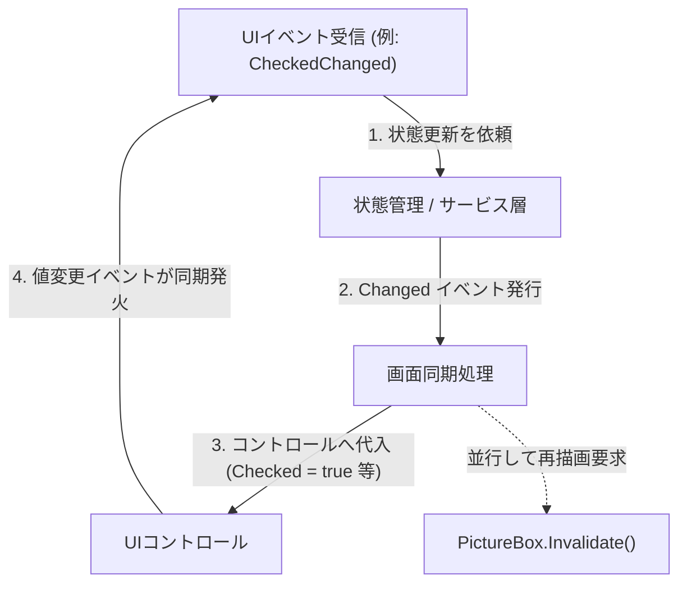
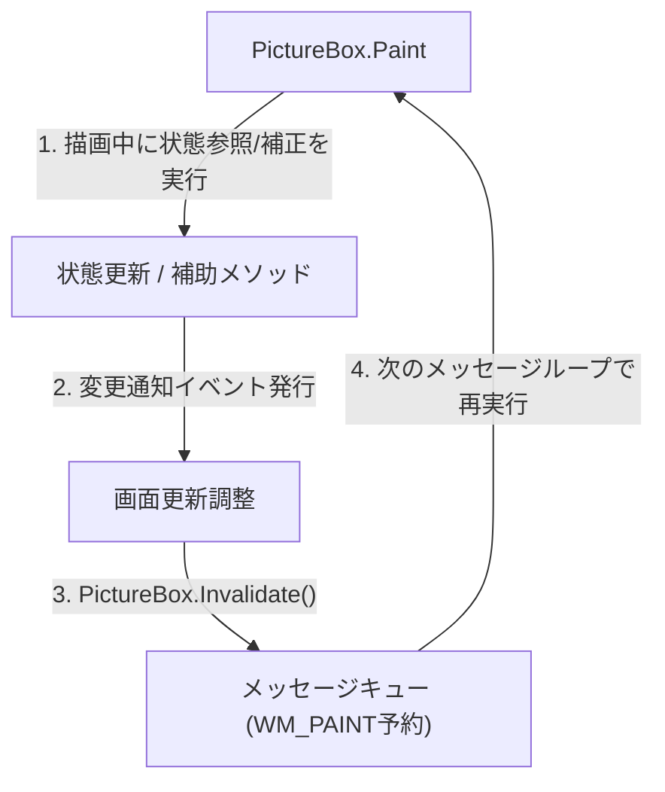
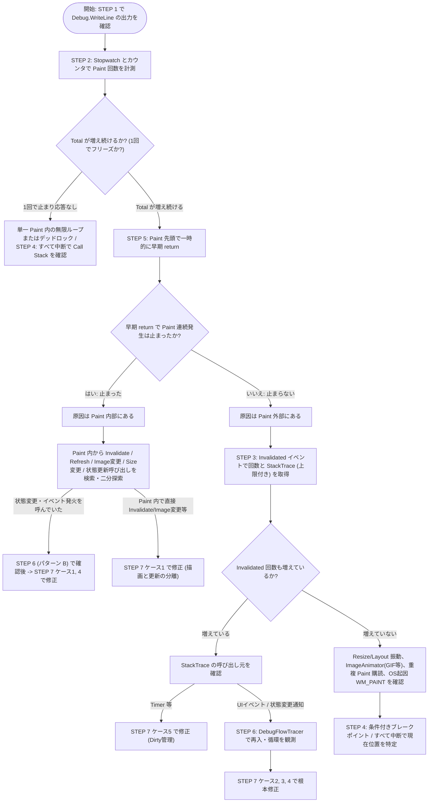

# WinForms `PictureBox.Paint` 描画無限ループ・連続発生のデバッグ手順書

## 0. はじめに（目的と前提）

本手順書は、**C# / Windows Forms / Visual Studio 2019** のアプリケーションにおいて、`PictureBox` の `Paint` イベントが異常な頻度で連続実行される（描画無限ループに陥る）現象を、**Visual Studio のデバッガーおよびログ出力を使って段階的に切り分け、原因を特定するための実践ガイド**です。

> [!NOTE]
> **推測ではなく観測事実から切り分ける**
> 描画が止まらない現象を見ると「どこかでイベント循環が起きている」「`Paint` の中で `Invalidate` している」と推測しがちですが、原因を決めつけると調査が遠回りになります。本書では、**観測された事実（ログ・発生回数・コールスタック）**を積み上げて原因箇所を絞り込む手順を説明します。

---

## 1. 基礎知識（デバッグ前に押さえるべきポイント）

### 1.1 `PictureBox.Paint` イベントはどのような条件で発生するのか？

WinForms における `Control.Paint`（`PictureBox.Paint` も継承元 `Control` の仕組みを利用）は、主に次の契機で発生します。

1. **アプリコードからの明示的な無効化・再描画要求**
   - `pictureBox.Invalidate()`（または領域指定の `Invalidate(Rectangle)`）が呼ばれ、コントロールのクライアント領域が「描画が必要（無効領域）」とマークされた後、メッセージループで `WM_PAINT` が処理されたとき。
   - `pictureBox.Refresh()` が呼ばれたとき（内部的に子コントロールを含めて無効化し、即座に再描画を実行します）。
   - `pictureBox.Update()` が呼ばれたとき（**すでに無効領域が存在する場合のみ**、メッセージキューの待機を待たず同期的に `WM_PAINT` を処理します）。
2. **`PictureBox` 固有のプロパティやレイアウトの変化**
   - `Image`、`ImageLocation`、`SizeMode`、`BackgroundImage` などの変更。
   - `Size`、`Location`、`Dock`、`Anchor`、親コンテナ（`Panel` や `SplitContainer` 等）のサイズ変更やスクロール。
3. **OS（Windows デスクトップウィンドウマネージャー / GDI）からの再描画要求**
   - ウィンドウの最小化からの復元、他ウィンドウやダイアログが上に重なった後の露出、移動、DPI 変更、テーマ変更など。
4. **親コントロールや隣接コントロールの再描画連鎖**
   - 透過背景風の描画や親コントロールの更新に伴って子コントロールに再描画が波及するケース。

---

### 1.2 「`Paint` の連続実行」と「単一 `Paint` 処理内の無限ループ」の違い

現象を観察するとき、まずこの 2 つを混同しないことが重要です。

| 観点 | `Paint` の連続実行（再描画ループ） | 単一 `Paint` 処理内の無限ループ |
| --- | --- | --- |
| **何が起きているか** | `Paint` ハンドラー自体は毎回最後まで `return` して終わるが、すぐ次の描画要求が来て何度も呼ばれる | 1 回の `Paint` ハンドラー内の `for` / `while` / 再帰から抜けられない |
| **UI の応答性** | 他の UI 操作が「重い・カクつく」ことはあるが、メッセージループが回るため完全に固まらない場合がある（CPU 負荷が高いと固まって見えることもある） | メッセージループに一切戻らないため、ウィンドウが完全にフリーズ（「応答なし」）する |
| **Call Stack の見え方** | 中断（Break All）すると、`Paint` が浅い位置にあり、呼び出し元に `WndProc` / メッセージループ（`Application.Run`）が見える | 中断すると、同じ `Paint` 内のループ行で止まり続ける（再帰ならスタックが極端に深くなり `StackOverflowException` に至る） |
| **出力ログの出方** | `Paint` の開始・終了ログが対になって大量に出力され続ける | 開始ログが 1 回だけ出て、終了ログが出ない（ループ内にログがあればそれだけが出る） |

---

### 1.3 原因の 2 つの方向性（切り分けの軸）

デバッグでは、最初に原因が次のどちらにあるかを切り分けます。

1. **`Paint` 内部起因**：`Paint` イベント内部、または `Paint` から呼び出す描画・補助処理が、直接または間接的に再描画（`Invalidate` / `Refresh` / プロパティ変更など）を要求している。
2. **`Paint` 外部起因**：`Paint` の外にある `Timer`、マウス/UI コントロールのイベント（`CheckedChanged`、`Resize` 等）、モデル/サービス層の変更通知イベントなどが繰り返し発生し、結果として `Paint` が高頻度で呼び出されている。

---

## STEP 1：ログ出力環境の準備（Visual Studio 2019）

まず、UI 操作を止めずに実行回数や呼び出し経路を観測できるよう、Visual Studio 2019 で `Debug.WriteLine` のログを確認できる環境を整えます。

### 操作

1. Visual Studio 2019 上部のツールバーで、ソリューション構成が **`Debug`** になっていることを確認します（`Release` になっていれば `Debug` に切り替えます）。
2. メニューから **［表示］→［出力］**（環境設定によっては `Ctrl + Alt + O`）をクリックし、**出力**ウィンドウを表示します。
3. 出力ウィンドウ上部のドロップダウン **「出力元の表示」** を **`デバッグ`** に変更します。
4. 動作確認のため、調査対象フォームの `Load` イベントなど起動時に 1 回だけ通る場所へ一時的な確認コードを追加し、**`F5`** キーでデバッグ実行します。

```csharp
using System;
using System.Diagnostics;
using System.Windows.Forms;

// 例：フォームの Load イベントなど、起動時に1回だけ呼ばれる箇所に一時追記
private void MainForm_Load(object sender, EventArgs e)
{
    // Debug.WriteLine は DEBUG シンボルが定義されたビルド（通常は Debug 構成）でのみ有効になります。
    // Release ビルドではコンパイラによって呼び出し自体が除外されます。
    Debug.WriteLine($"[DEBUG-CHECK] Form Load 実行時刻: {DateTime.Now:HH:mm:ss.fff}");

    // 以下、既存の初期化処理...
}
```

#### `Debug.WriteLine` が表示されない場合の確認事項

出力ウィンドウに何も表示されない場合は、次の項目を上から順に確認してください。

1. **ビルド構成が `Debug` か**
   - `Release` 構成では `DEBUG` 条件付きコンパイルシンボルが定義されていないことが一般的であり、`[Conditional("DEBUG")]` が付いた `Debug.WriteLine` はビルド時に除去されます。
   - プロジェクトのプロパティ →［ビルド］タブで、現在の構成（`Debug`）に **「DEBUG 定数の定義」** チェックが入っているかも確認してください。
2. **「出力元の表示」が `デバッグ` になっているか**
   - 「ビルド」や「ソース管理」など別の出力元が選択されていると、デバッグ出力は見えません。
3. **「イミディエイト ウィンドウ」にリダイレクトされていないか**
   - Visual Studio 2019 のメニュー **［ツール］→［オプション］→［デバッグ］→［全般］** にある **「すべての出力ウィンドウのテキストをイミディエイト ウィンドウにリダイレクトする」** にチェックが入っていると、出力ウィンドウではなくイミディエイト ウィンドウに表示されます（確認したい場所に合わせて設定を切り替えるか、［デバッグ］→［ウィンドウ］→［イミディエイト］を確認してください）。
4. **`F5`（デバッグ開始）で実行しているか**
   - `Ctrl + F5`（デバッグなしで開始）ではデバッガーがアタッチされないため、Visual Studio の出力ウィンドウには表示されません。
5. **スタートアッププロジェクトが正しいか**
   - ソリューションに複数プロジェクトがある場合、調査コードを書いたプロジェクトとは別の実行ファイルが起動していないか確認してください。
6. **補足：`Trace.WriteLine` との違い**
   - `Debug.WriteLine` は主に `DEBUG` 構成用、`Trace.WriteLine` は `TRACE` シンボル定義時（多くの場合 `Debug` / `Release` 両方）に有効です。調査後の消し忘れによる本番影響を抑えるため、一時調査には `Debug.WriteLine` を推奨します。

### 期待される結果

- 出力ウィンドウ（出力元：`デバッグ`）に `[DEBUG-CHECK] Form Load 実行時刻: ...` という行が 1 行表示される。

### 結果から分かること

- Visual Studio 2019 のデバッグログ出力経路が正常に機能しており、以降のステップで回数計測やコールスタックを観測できる状態であることが確認できます。

### 次の調査先

- ログ出力が確認できたら、**STEP 2** に進み、`PictureBox.Paint` の発生頻度・回数を定量的に計測します。

---

## STEP 2：`Paint` の発生回数を計測する

`Paint` が「高速に何度も起きている」のか、あるいは「1 回の中で止まっている」のかを数値で確認します。毎回の `Paint` で無条件に `Debug.WriteLine` を呼ぶと出力負荷でアプリが極端に遅くなり現象が変わってしまうため、**一定回数ごと（間引き）＋ `Stopwatch` による時間計測**を使います。

### 計測対象となるコード箇所

- 対象の `PictureBox.Paint` に登録されているイベントハンドラー（デザイナーの `InitializeComponent()` 内で `+= new PaintEventHandler(...)` されている箇所、またはコード上で `+=` している箇所）。
- `PictureBox` を継承したカスタムコントロールで `OnPaint(PaintEventArgs e)` をオーバーライドしている場合は、そのメソッドも対象です。

### サンプルコード（汎用的な計測用スニペット）

```csharp
using System;
using System.Diagnostics;
using System.Windows.Forms;

public partial class TargetForm : Form
{
    // --- STEP 2 調査用フィールド（調査完了後に必ず削除する） ---
    // Paint イベントが合計何回呼ばれたかを記録するカウンタ
    private long _debugPaintTotalCount = 0;

    // 前回の計測区間から何回呼ばれたかを記録するカウンタ
    private long _debugPaintWindowCount = 0;

    // 経過時間を高精度に計測するための Stopwatch
    private readonly Stopwatch _debugPaintStopwatch = Stopwatch.StartNew();

    // ログ出力を間引く間隔（例：100回ごと、または1000ミリ秒ごと）
    private const int DebugPaintLogIntervalCount = 100;
    private const long DebugPaintLogIntervalMs = 1000;
    // -------------------------------------------------------------

    private void pictureBoxTarget_Paint(object sender, PaintEventArgs e)
    {
        // 【1】開始時点でカウントアップ
        _debugPaintTotalCount++;
        _debugPaintWindowCount++;

        long elapsedMs = _debugPaintStopwatch.ElapsedMilliseconds;

        // 【2】「一定回数に達した」または「1秒経過した」ときだけログ出力する
        // 毎回 Debug.WriteLine を呼ぶと I/O 負荷で現象が歪むため、必ず間引く
        if (_debugPaintWindowCount >= DebugPaintLogIntervalCount || elapsedMs >= DebugPaintLogIntervalMs)
        {
            // 1秒あたりの発生回数（Paint/sec）の概算を算出（ゼロ除算防止）
            double paintsPerSec = elapsedMs > 0
                ? (_debugPaintWindowCount * 1000.0) / elapsedMs
                : _debugPaintWindowCount;

            Debug.WriteLine(
                $"[PAINT-METER] Total={_debugPaintTotalCount}, " +
                $"WindowCount={_debugPaintWindowCount}, " +
                $"Elapsed={elapsedMs}ms, " +
                $"Rate={paintsPerSec:F1} paints/sec");

            // 区間カウンタとストップウォッチをリセットして次の計測へ
            _debugPaintWindowCount = 0;
            _debugPaintStopwatch.Restart();
        }

        // 【3】ここから既存の描画処理...
    }
}
```

> [!TIP]
> 1 秒間に数回程度しか起きていない場合（`100` 回に達しない場合）でも `elapsedMs >= 1000` の条件により 1 秒ごとに出力されます。逆に 1 秒間に何千回も起きている場合は 100 回ごとに出力されるため、環境に応じて定数を調整してください。

### 操作

1. `PictureBox.Paint` ハンドラー（または `OnPaint`）の先頭に、上記の計測コードを一時的に組み込みます。
2. `Debug` 構成で `F5` 実行し、問題が再現する画面・操作状態まで進めます。
3. 操作を止め、マウスも動かさない状態で 10 秒ほど出力ウィンドウのログの増え方を観察します。

### 期待される結果

- 正常時：操作を止めると `Rate` は `0` に落ち着き、出力は止まるか 1 秒に 0〜1 回未満になります。
- 異常時：操作を止めていても `[PAINT-METER]` が連続出力され続け、`Total` が急増します（例：`Rate=60.0 paints/sec` 以上、あるいは数百〜数千 `paints/sec`）。

### 結果から分かること

- **「単一 `Paint` 内の無限ループ」か「`Paint` の連続実行」か**が確定します。
  - `Total` が増え続けるなら、**`Paint` が毎回最後まで抜けて繰り返し実行されている（連続実行）**ことが事実として確認できます。
  - `Total=1` のまま UI が応答なしになるなら、**単一 `Paint` 内の無限ループ**（またはデッドロック）です。

### 次の調査先

- `Paint` が連続実行されていることが確認できたら、**STEP 3** に進み、`Invalidate()` が呼ばれているかを `Invalidated` イベントで観測します。
- 単一 `Paint` 内で止まっている場合は、**STEP 4** の「すべて中断（Break All）」へ直接進みます。

---

## STEP 3：`Invalidated` イベントの調査

`Paint` が連続実行されているとき、次に知りたいのは**「誰が再描画を要求しているのか」**です。その手がかりとして、`PictureBox.Invalidated` イベントを一時的に購読し、スタックトレースを採取します。

### 3.1 `Invalidate` と `Invalidated`、`Paint` の関係と違い


- **`Invalidate()` と `Invalidated` の関係**
  - コントロールの `Invalidate()` が呼ばれ、再描画が必要（無効）とマークされたタイミングで `Invalidated` イベントが発生します（WinForms の標準的な挙動として、無効化メソッドの呼び出しと同期して発火します）。
- **`Invalidated` と `Paint` の違い**
  - `Invalidated` は「無効化された**瞬間**」に同期的に呼ばれます。
  - `Paint` はその後、メッセージループが `WM_PAINT` を処理するタイミング（非同期・遅延、複数の `Invalidate` が 1 回にまとまることもある）で呼ばれます。そのため、**`Paint` ハンドラー内でコールスタックを見ても、`Invalidate()` を呼んだ犯人はすでにスタックから消えている**のが普通です。
- **`Invalidated` が発生しなくても `Paint` が発生し得る理由**
  - OS 側が直接 `WM_PAINT` を発生させる場合（他ウィンドウが重なった後の再露出、ウィンドウ移動、DPI 変更、ネイティブレベルの無効化など）、マネージコード側の `Control.Invalidate()` を経由しないため、`Invalidated` イベントが発火せずに `Paint` だけが呼ばれることがあります。
  - `Control` の内部スタイルや親コントロール・システム側のウィンドウメッセージ処理によっては、明示的な `Invalidate()` とは異なる経路で `WM_PAINT` が送られる場合があります。
- **`Invalidated` の呼び出し履歴から原因を特定できる場合とできない場合**
  - **特定できる場合**：アプリコードの誰かが `pictureBox.Invalidate()` や `Refresh()` を呼んでいる場合。スタックトレースにその呼び出し元メソッド名が出現します。
  - **特定できない（または分かりにくい）場合**：
    1. `Invalidated` 自体が増えていないのに `Paint` だけが増えている（OS 起因の `WM_PAINT` 等）。
    2. `Invalidated` は起きているが、スタックトレースが `Control.SetBoundsCore` や `PictureBox.set_Image` などのプロパティ変更経由になっている（さらにその変更元を追う必要がある）。
    3. `Timer` や非同期コールバックが毎回別ターンで `Invalidate()` を呼んでいるため、1 回のスタックだけでは「なぜ繰り返し呼ばれるか」の全体像が見えない（この場合は STEP 6 の実行フロー追跡と組み合わせる）。

### 3.2 スタックトレース取得の負荷への配慮

`new StackTrace(true)`（ファイル名と行番号を取得するモード）は PDB シンボルの解析を行うため**非常に重い処理**です。毎秒何百回も発火する状況で無制限に呼び出すと Visual Studio ごと固まったように見えるため、必ず以下を守ってください。

- **出力上限回数**（例：最初の 10 回だけ出力して止める）を設ける。
- 上限に達した後は**回数のみの間引き出力**に切り替える。
- まずは `fNeedFileInfo: false` で軽量に試し、行番号が欲しい場合だけ上限付きで `true` にする。

### サンプルコード（汎用的な `Invalidated` 調査コード）

```csharp
using System;
using System.Diagnostics;
using System.Windows.Forms;

public partial class TargetForm : Form
{
    // --- STEP 3 調査用フィールド（調査完了後に必ず削除する） ---
    private long _debugInvalidatedCount = 0;
    private int _debugStackTracePrintedCount = 0;

    // スタックトレースは非常に重いため、最大出力回数を制限する
    private const int MaxStackTraceLogs = 10;
    // -------------------------------------------------------------

    // 初期化時（Load 等）に一時的にイベント購読を登録する
    private void AttachDebugInvalidatedLogger()
    {
        pictureBoxTarget.Invalidated += PictureBoxTarget_DebugInvalidated;
    }

    private void DetachDebugInvalidatedLogger()
    {
        pictureBoxTarget.Invalidated -= PictureBoxTarget_DebugInvalidated;
    }

    private void PictureBoxTarget_DebugInvalidated(object sender, InvalidateEventArgs e)
    {
        _debugInvalidatedCount++;

        // 上限回数に達するまでだけスタックトレースを出力する（負荷対策）
        if (_debugStackTracePrintedCount < MaxStackTraceLogs)
        {
            _debugStackTracePrintedCount++;

            // skipFrames: 1 でこのメソッド自身をスキップ
            // fNeedFileInfo: true で行番号も取得（重いので MaxStackTraceLogs で必ず制限する）
            var st = new StackTrace(skipFrames: 1, fNeedFileInfo: true);

            Debug.WriteLine(
                $"=== [INVALIDATED #{_debugInvalidatedCount}] Region={e.InvalidRect} ===");
            Debug.WriteLine(st.ToString());
        }
        else if (_debugInvalidatedCount % 200 == 0)
        {
            // 上限後は回数だけ間引き出力して負荷を抑える
            Debug.WriteLine($"[INVALIDATED] TotalCount={_debugInvalidatedCount}");
        }
    }
}
```

### 操作

1. 対象フォームの初期化処理（`Load` や `InitializeComponent()` の後）に `AttachDebugInvalidatedLogger()` を一時的に追加します。
2. フォームを閉じるとき（`FormClosed` 等）に `DetachDebugInvalidatedLogger()` を呼ぶようにします。
3. `Debug` 構成で `F5` 実行し、問題が発生する状況を作って出力ウィンドウを確認します。

### 期待される結果

次のいずれかのパターンが観測されます。

- **パターン A**：`[INVALIDATED #1]` 〜 `#10` が連続で出力され、スタックトレースにアプリ側のメソッド（例：`pictureBoxTarget_Paint`、`timer1_Tick`、`PictureBox.set_Image`、イベントハンドラー等）が記録される。
- **パターン B**：STEP 2 の `[PAINT-METER]` は増え続けているのに、`[INVALIDATED]` の回数が増えない（初期の数回だけで止まっている）。

### 結果から分かること

- **パターン A の場合**：アプリコードや WinForms プロパティ変更経由で**無効化が繰り返し呼ばれている**ことが確定します。スタックトレースに出たメソッド名がそのまま次の調査ターゲットになります。
  - スタックトレース内に `Paint` ハンドラー自身が含まれていれば、**`Paint` 内部起因**が濃厚です。
  - スタックトレース内にタイマーや他コントロール・状態変更通知が含まれていれば、**外部起因またはイベント循環**が濃厚です。
- **パターン B の場合**：アプリ側の `Invalidate()` 呼び出しではなく、**OS からの `WM_PAINT` 再送やレイアウト・ネイティブ処理等**が疑われます。

### 次の調査先

- スタックトレースに出た疑わしいメソッドや、パターン B で実行中の処理の中身をリアルタイムで確認するため、**STEP 4（Visual Studio のデバッガー操作）**に進みます。

---

## STEP 4：Visual Studio 2019 のデバッガー操作

ログだけでは「その瞬間の変数の値」「ループ内の分岐」「今まさにどこで時間を使っているか」が分かりにくい場合、Visual Studio 2019 のデバッガーを併用します。

### 4.1 ブレークポイント・条件付きブレークポイント・ヒットカウント

#### 1. 通常のブレークポイント
- **操作**：コードエディタの左端の余白をクリックするか、対象行にカーソルを置いて **`F9`** キーを押します。
- **注意点**：連続発生中の `Paint` にそのまま置くと、実行するたびに停止して操作できなくなります。連続発生時は次の条件付き／ヒットカウントを使います。

#### 2. 条件付きブレークポイント
- **操作**：
  1. 赤いブレークポイントを右クリック → **［条件...］** を選択します。
  2. 「条件」にチェックを入れ、たとえば `_debugPaintTotalCount > 50` や特定フラグが `true` のときなどの条件式を入力します。
  3. 停止させずにログだけ出したい場合は「アクション」にチェックを入れ、`Paint count={_debugPaintTotalCount}` 等と記述します（トレースポイント）。

#### 3. ヒットカウント
- **操作**：
  1. ブレークポイントを右クリック → **［条件...］** を開きます。
  2. ドロップダウンから **「ヒット カウント」** を選択します。
  3. 「次の値と等しい」（例：`100`）や「次の値の倍数」（例：`50`）を指定します。
- **使いどころ**：起動直後の正常な数回の描画を素通りさせ、「100 回目の `Paint` に入った瞬間」だけを捕まえたいときに有効です。

---

### 4.2 すべて中断（Break All）と呼び出し履歴（Call Stack）

現象が暴走している最中に「今まさに動いている処理」を直接捕まえる操作です。

- **操作**：
  1. `F5` で実行し、`Paint` が連続発生している（またはフリーズしている）状態にします。
  2. Visual Studio 2019 のメニューから **［デバッグ］→［すべて中断］** をクリックします（標準キー設定では `Ctrl + Alt + Break` ですが、環境によりキーが異なる・`Break` キーがない場合はメニューから実行します）。
  3. 中断されたら、**［デバッグ］→［ウィンドウ］→［呼び出し履歴］** を開きます。
- **確認のポイント**：
  - 呼び出し履歴ウィンドウ内で右クリックし、必要に応じて **［外部コードの表示］** をオンにすると、`System.Windows.Forms.dll` 内のフレームも確認できます。
  - **1 回だけ中断しても偶然別の箇所で止まることがある**ため、「続行（`F5`）→ すぐ［すべて中断］」を 3〜5 回ほど繰り返し、毎回同じ箇所・経路で止まっているかを見比べます。

---

### 4.3 ステップイン（`F11`）とステップアウト（`Shift + F11`）

- **ステップイン（`F11`）**
  - 現在行が呼び出しているメソッドの**内部**に入ります。`Paint` の中で呼んでいる描画ヘルパーや状態取得メソッドが、内部で `Invalidate()` やプロパティ書き換えを行っていないか 1 階層ずつ確認するときに使います。
- **ステップアウト（`Shift + F11`）**
  - 現在のメソッドを最後まで実行し、**呼び出し元に戻った直後**で止めます。深い処理を抜けた直後にどこへ戻るか、あるいは `Paint` を抜けた直後に何が起きるかを追うときに使います。

---

### 4.4 フレームワーク内部に関数ブレークポイントを置く場合の制約と設定

「ソースコードに手を加えずに `Control.Invalidate` が呼ばれた瞬間を止めたい」場合、**関数のブレークポイント**（［デバッグ］→［新しいブレークポイント］→［関数のブレークポイント］で `System.Windows.Forms.Control.Invalidate` 等を指定）を使う手法があります。ただし Visual Studio 2019 では以下の制約に注意してください。

1. **「マイ コードのみ（Just My Code）」による制約**
   - 既定では［マイ コードのみ］が有効になっており、フレームワーク内部（`System.Windows.Forms.dll`）にはブレークポイントが張れない・ステップインできない・呼び出し履歴で `[外部コード]` として折りたたまれることがあります。
   - **変更場所**：**［ツール］→［オプション］→［デバッグ］→［全般］** の **「マイ コードのみを有効にする」** のチェックを一時的に外します。
2. **シンボル（PDB）の読み込みが必要**
   - フレームワーク内部の関数名でブレークポイントを解決するには、Microsoft のシンボルファイルが必要です。
   - **変更場所**：**［ツール］→［オプション］→［デバッグ］→［シンボル］** で **「Microsoft シンボル サーバー」** にチェックを入れます（初回実行時はダウンロードのため起動や中断に時間がかかる場合があります）。
   - ※プロキシやオフライン環境でシンボルを取得できない場合は、白抜きの丸（「シンボルが読み込まれていません」）となり機能しないことがあります。その場合は **STEP 3 の `Invalidated` イベント購読**を優先してください。
3. **オーバーロードによる複数一致**
   - `Control.Invalidate` には引数違いのオーバーロードが複数存在するため、関数名だけで指定すると複数箇所にブレークポイントが設定される場合があります。

### 操作（STEP 4 のまとめ手順）

1. `Paint` ハンドラー先頭に条件付きブレークポイントまたはヒットカウント（例：`50`）を設定し、停止時の**［呼び出し履歴］**とローカル変数を観察します。
2. 暴走中に **［デバッグ］→［すべて中断］** を数回実行し、共通して出現する呼び出し履歴を確認します。
3. 疑わしいメソッド呼び出しで **`F11`（ステップイン）**、抜ける際に **`Shift + F11`（ステップアウト）** を使って内部挙動を追跡します。

### 期待される結果

- 呼び出し履歴ウィンドウに、停止時点のコールスタックおよび各変数状態が表示される。

### 結果から分かること

- 単一 `Paint` 内の無限ループであれば、中断した瞬間の行から即座にループ箇所を特定できます。
- 連続実行であれば、`Paint` 内部で呼ばれている怪しい処理、あるいは頻繁に実行されている外部処理を特定できます。

### 次の調査先

- デバッガーで動きを把握したら、**STEP 5** に進み、「`Paint` の中を空にしたら現象が止まるか」で内部起因か外部起因かを確定させます。

---

## STEP 5：`Paint` 内部と外部の切り分け

原因を最速で半分に絞る方法は、**「`Paint` の中身を一時的に空（早期 `return`）にしたとき、現象が止まるか？」**を確認することです。

### 5.1 `Paint` 内部の描画処理を一時的に無効化する方法

`PictureBox.Paint` ハンドラーの先頭で、STEP 2 の計測ログだけを残して**一時的に早期 `return`** します。

```csharp
private void pictureBoxTarget_Paint(object sender, PaintEventArgs e)
{
    // STEP 2 の計測コードだけは残す（回数が増え続けるか観測するため）
    _debugPaintTotalCount++;
    _debugPaintWindowCount++;
    long elapsedMs = _debugPaintStopwatch.ElapsedMilliseconds;
    if (_debugPaintWindowCount >= 100 || elapsedMs >= 1000)
    {
        Debug.WriteLine($"[PAINT-METER-EMPTY] Total={_debugPaintTotalCount}, Window={_debugPaintWindowCount}, Elapsed={elapsedMs}ms");
        _debugPaintWindowCount = 0;
        _debugPaintStopwatch.Restart();
    }

    // --- STEP 5 切り分け用：一時的に既存の描画処理をすべてスキップする ---
    // ※調査が終わったら必ずこの return を削除する
    return;

    // ここから下に既存の描画処理がある...
}
```

> [!NOTE]
> `PictureBox` を継承したカスタムコントロールで `OnPaint` をオーバーライドしている場合は、`base.OnPaint(e);` だけを残して独自描画処理をスキップする確認も行ってください。

### 5.2 特に調査対象とすべき処理一覧

ソリューション全体検索（`Ctrl + Shift + F`）やコールスタック確認では、特に次の 8 項目を重点的にチェックしてください。

| 調査対象 | 無限ループ・連続発生を引き起こす典型的な理由 | 確認方法 |
| --- | --- | --- |
| **`PictureBox.Invalidate()`** | `Paint` 内または `Paint` が呼ぶメソッド内で実行すると、描画終了直後に次の `WM_PAINT` が予約され無限に繰り返す | ソリューション全体で `.Invalidate(` を検索 |
| **`PictureBox.Refresh()`** | 無効化＋即時再描画を行うため、`Paint` 内で呼ぶと再帰（最悪 `StackOverflowException`）や連続発火を起こす | `.Refresh(` を全件検索 |
| **`PictureBox.Update()`** | 無効領域がある状態で呼ぶと即座に `Paint` が走る。`Invalidate()` と組でループ内に置かれると強制連続描画になる | `.Update(` を全件検索 |
| **`PictureBox.Image` の変更** | `pictureBox.Image = ...` の代入は通常再描画を伴う。`Paint` 内で `Image` を差し替えたり、描画用 Bitmap を毎回代入したりすると再描画が連鎖する | `.Image =` の代入箇所を全件検索 |
| **`PictureBox.Size` / `Location` の変更** | サイズや位置、`SizeMode`、`Dock`、`Anchor` を `Paint` 内や連動イベント内で変更するとレイアウト再計算と再描画が連鎖する | `.Size =`、`.Width =`、`.Height =`、`.Location =`、`.Bounds =`、`.SizeMode =` を確認 |
| **描画処理内部からの状態更新・イベント発火呼び出し** | `Paint` の中でデータを補正・更新するメソッドを呼んでしまい、状態変更イベント経由で再び `Invalidate()` が返ってくる | `Paint` から辿れるすべての呼び出し先を `F11` や検索で確認 |
| **`Timer` による画面更新** | `System.Windows.Forms.Timer` 等の `Tick` が短い間隔で動いており、変化がなくても無条件で `Invalidate()` / `Refresh()` を呼んでいる | デザイナーおよびコード上の `Timer` 全件と `Tick` ハンドラーを確認 |
| **UI のレイアウト変更による再描画** | `Layout`、`Resize`、`SizeChanged`、`VisibleChanged`、親パネルの `AutoScroll` 領域変更（スクロールバーの出入りによるサイズ振動ループ等） | `Layout` / `Resize` / `SizeChanged` ハンドラーおよび `SuspendLayout` / `ResumeLayout` 周辺を確認 |

### 5.3 描画処理を無効化しても問題が続く場合の調査方法

早期 `return;` を入れて **`Paint` の中身を空にしたにもかかわらず `[PAINT-METER-EMPTY]` が増え続ける場合**、原因は **`Paint` ハンドラーの外部** にあります。次の順で確認します。

1. **STEP 3 の `Invalidated` ログが同時に増えているか確認する**
   - **増えている場合**：`Paint` の外にある誰かが `Invalidate()` / `Refresh()` / `Image` 変更 / サイズ変更を呼び続けています。STEP 3 のスタックトレースをそのまま追います。
   - **増えていない場合**：次の項目（`Timer` や OS / レイアウト / `ImageAnimator` 等）を確認します。
2. **フォーム上の `Timer` や非同期ループを一時停止する**
   - `System.Windows.Forms.Timer` 等の `Enabled = false` にして現象が止まるか確認します。
3. **`PictureBox.Image` のアニメーションや親レイアウト振動を疑う**
   - アニメーション GIF 等が `Image` に設定されていると、`PictureBox` 内部の `ImageAnimator` がフレーム更新のため定期的に再描画を要求し続けます。
   - `Resize` / `Layout` イベントにも回数カウンタを入れ、スクロールバーの出現・消滅などによるサイズ振動ループが起きていないか確認します。
4. **他のイベントや重複購読を検索する**
   - `MouseMove` や `GotFocus` / `LostFocus` 内で無条件に `Invalidate()` していないか確認します。
   - 同じ `PictureBox` に別の `Paint` ハンドラーが複数登録されていないか、`.Paint +=` を全検索して確認します。

### 操作

1. `Paint` ハンドラーの計測コード直後に一時的な `return;` を入れます。
2. `F5` で実行し、`[PAINT-METER-EMPTY]` の出力回数を観察します。
3. 止まった場合は `return;` の位置を下にずらす「二分探索」で原因の行・呼び出しを絞り込みます。止まらない場合は「5.3」の外部要因を確認します。

### 期待される結果

- `Paint` 内部に原因があれば、早期 `return;` を入れた時点で連続発生が止まる。
- `Paint` 外部に原因があれば、早期 `return;` を入れてもカウントが増え続ける。

### 結果から分かること

- **原因の所在が「`Paint` の内側」か「`Paint` の外側」か**が確定します。

### 次の調査先

- 内部または外部で**イベントの連鎖・再入**が疑われる場合、**STEP 6（イベント循環の観測手順）**に進み、メソッドの実行順とネスト深さをログで可視化します。
- 単一の `Timer` や直接的な `Invalidate()` 呼び出しが特定できた場合は、**STEP 7** の該当ケースへ進みます。

---

## STEP 6：イベント循環のデバッグ調査

`Paint` の呼び出し元や更新処理を辿った結果、複数のコンポーネントや UI イベントをまたいでループしている疑いがある場合は、**実行順序と再入深さ（ネスト深さ）**をログで可視化して循環の有無を確認します。

### 6.1 デバッグでよく観測される 2 つのイベント循環パターン（検証対象の仮説）

#### パターン A：UI コントロールの更新と変更通知の循環（`Paint` 外部）
状態変更通知を受けて UI コントロール（`RadioButton.Checked`、`CheckBox.Checked`、`ComboBox.SelectedIndex`、`NumericUpDown.Value` 等）をコードから書き換えた際、WinForms が `CheckedChanged` 等を発火し、それが再び状態更新処理を呼んでしまう循環です。



#### パターン B：描画処理（`Paint`）を起点とした再描画循環（`Paint` 内部起点）
`PictureBox.Paint` の内部から呼び出した処理が状態変更イベントやプロパティ更新を起こし、巡り巡って `PictureBox.Invalidate()` に戻ってくる循環です。



---

### 6.2 循環と再入を観測するためのトレーサー（デバッグ用コード）

循環が疑われるメソッド群（`Paint`、再描画要求メソッド、状態変更通知の発行元・受信先、UI の `CheckedChanged` / `SelectedIndexChanged` 等）の入口・出口に一時的なトレーサーを差し込みます。

```csharp
using System;
using System.Diagnostics;
using System.Threading;

// 調査中のみ使用する一時的なトレーサー（調査完了後にクラスごと削除する）
// 呼び出し順序とネスト深さ（再入）を可視化する
internal static class DebugFlowTracer
{
    private static int _depth = 0;
    private static long _seq = 0;
    private const int MaxTraceLines = 200; // ログ爆発防止の上限

    public static IDisposable TraceScope(string methodName, string detail = "")
    {
        long currentSeq = Interlocked.Increment(ref _seq);
        int currentDepth = _depth;
        _depth++;

        if (currentSeq <= MaxTraceLines)
        {
            string indent = new string(' ', currentDepth * 2);
            Debug.WriteLine(
                $"[FLOW #{currentSeq:D4} D={currentDepth}] {indent}-> {methodName} {detail}");
        }

        return new ScopeExit(methodName, currentSeq, currentDepth);
    }

    private sealed class ScopeExit : IDisposable
    {
        private readonly string _name;
        private readonly long _seq;
        private readonly int _depth;

        public ScopeExit(string name, long seq, int depth)
        {
            _name = name;
            _seq = seq;
            _depth = depth;
        }

        public void Dispose()
        {
            _depth--;
            if (_seq <= MaxTraceLines)
            {
                string indent = new string(' ', _depth * 2);
                Debug.WriteLine($"[FLOW #{_seq:D4} D={_depth}] {indent}<- {_name}");
            }
        }
    }
}
```

調査したいメソッドの先頭を `using (DebugFlowTracer.TraceScope(...))` で囲みます。

```csharp
// 例1：Paint ハンドラー
private void pictureBoxTarget_Paint(object sender, PaintEventArgs e)
{
    using (DebugFlowTracer.TraceScope("TargetForm.pictureBoxTarget_Paint"))
    {
        // 既存の描画処理...
    }
}

// 例2：状態変更イベントの発行箇所
private void RaiseStateChanged(string reason)
{
    using (DebugFlowTracer.TraceScope("StateManager.RaiseStateChanged", $"reason={reason}"))
    {
        StateChanged?.Invoke(this, EventArgs.Empty);
    }
}

// 例3：UI コントロールのイベントハンドラー
private void radioMode_CheckedChanged(object sender, EventArgs e)
{
    using (DebugFlowTracer.TraceScope("TargetForm.radioMode_CheckedChanged", $"Checked={radioMode.Checked}"))
    {
        // 状態更新や再描画処理...
    }
}
```

### 操作

1. STEP 3〜5 で怪しいと判明したメソッド群に `DebugFlowTracer.TraceScope` を一時的に追加します。
2. `Debug` 構成で `F5` 実行し、出力ウィンドウの最初の 200 行をテキストエディタにコピーして流れを確認します。

### 期待される結果

インデントと深さ `D=` 付きの実行ログが出力されます。

- **同期イベント循環（パターン A）の例**：`D=` が戻らずに深くネストし続ける（または折り返す）
  ```text
  [FLOW #0010 D=0] -> radioMode_CheckedChanged Checked=True
  [FLOW #0011 D=1]   -> RaiseStateChanged reason=ModeChange
  [FLOW #0012 D=2]     -> SyncUiFromState
  [FLOW #0013 D=3]       -> radioMode_CheckedChanged Checked=False
  ```
- **非同期・メッセージループ経由の再描画循環（パターン B）の例**：`Paint` が `D=0` で終了した直後に再び `D=0` で始まる
  ```text
  [FLOW #0020 D=0] -> pictureBoxTarget_Paint
  [FLOW #0021 D=1]   -> SomeMethodCalledFromPaint
  [FLOW #0022 D=2]     -> RaiseStateChanged
  [FLOW #0023 D=3]       -> pictureBoxTarget.Invalidate
  [FLOW #0020 D=0] <- pictureBoxTarget_Paint
  [FLOW #0024 D=0] -> pictureBoxTarget_Paint   <-- 直後にまた Paint が始まる
  ```

### 結果から分かること

- 推測ではなく**実際の実行順とネスト深さ**から、「どのイベントとどの処理が輪を作っているか」を確定できます。

### 次の調査先

- 特定できたループの切れ目（原因箇所）に対して、**STEP 7** の根本対策を適用します。

---

## STEP 7：原因別の修正方法と再発防止

原因が特定できたら修正を行います。このとき、**「応急処置」と「根本対策」を明確に区別すること**が重要です。

### 7.0 応急処置と根本対策の区別

| 区分 | アプローチ例 | 特徴とリスク |
| --- | --- | --- |
| **応急処置（対症療法）** | ・`bool _isPainting` フラグを置き、描画中の `Invalidate()` だけ黙って無視する<br>・`Timer` の間隔を長くするだけ<br>・一定時間以内の再描画要求を間引く | **表面上の無限ループは止まっても、不要なイベント発火や状態更新が裏で起き続ける。** 後から別の UI や機能を追加した際に「画面が更新されない」等の不具合を招きます。 |
| **根本対策（原因除去）** | ・`Paint` から状態変更・再描画要求を完全に排除する<br>・プログラムからの UI 更新とユーザー操作を分離する<br>・状態が変わっていないなら変更通知を出さない（同値ガード）<br>・表示状態と業務状態を分離する | そもそも不要なイベントや再描画要求が**発生しない構造**にする。調査で特定した循環の輪を論理的に断ち切る。 |

---

### 7.1 ケース1：`Paint` 内部で `Invalidate` 等を繰り返していた場合

#### 問題の本質
`Paint` は「現在の状態を読み取って描くだけ（副作用なし）」であるべきですが、その中で `Invalidate()`、`Refresh()`、`Image` 差し替え、`Size` 変更などを行っています。

#### 根本対策：描画と状態更新・リソース生成を分離する

```csharp
// 【修正例：ケース1】Paint は「読む・描く」だけに徹する
private void pictureBoxTarget_Paint(object sender, PaintEventArgs e)
{
    // NG例：Paint の中で画像やサイズを変えたり、Invalidate() を呼んだりしない
    // pictureBoxTarget.Image = CreateOverlayBitmap(); // <- 再描画を誘発する
    // pictureBoxTarget.Invalidate();                  // <- 絶対NG

    // OK例：すでに準備された描画データを読み取って e.Graphics に描くだけにする
    DrawCurrentContent(e.Graphics);
}

// ビットマップの再構築やレイアウト調整が必要な場合は、データ更新時や Resize 時など Paint の外で行う
private void OnDataOrViewChanged()
{
    UpdateCachedResourcesIfNeeded();
    pictureBoxTarget.Invalidate();
}
```

---

### 7.2 ケース2：ラジオボタン等の `CheckedChanged` が再入していた場合

#### 問題の本質
状態同期のためにコードから `radioButton.Checked = true` を代入した際、`CheckedChanged` が発火し、それをユーザー操作として処理して再び状態更新・再描画が走っています。

#### 根本対策：同値ガード ＋ `try/finally` による UI 更新抑制

```csharp
// 【修正例：ケース2】「プログラムからの同期更新」と「ユーザー操作」を分離する
private bool _isUpdatingUi = false;

public void SyncModeToUi(EditMode mode)
{
    bool shouldSelectA = (mode == EditMode.ModeA);
    bool shouldSelectB = (mode == EditMode.ModeB);

    // 【対策1：同値ガード】すでに表示が一致しているなら何もしない
    if (radioModeA.Checked == shouldSelectA && radioModeB.Checked == shouldSelectB)
    {
        return;
    }

    // 【対策2：UI更新中のイベント抑制】例外時も確実に解除されるよう try-finally を使う
    _isUpdatingUi = true;
    try
    {
        radioModeA.Checked = shouldSelectA;
        radioModeB.Checked = shouldSelectB;
    }
    finally
    {
        _isUpdatingUi = false;
    }
}

private void radioModeA_CheckedChanged(object sender, EventArgs e)
{
    // プログラムからの同期更新中は処理しない
    if (_isUpdatingUi)
    {
        return;
    }

    // ラジオボタンは OFF 側と ON 側の両方で CheckedChanged が発火するため、Checked == true のみ扱う
    if (!radioModeA.Checked)
    {
        return;
    }

    ApplyModeFromUser(EditMode.ModeA);
}
```

---

### 7.3 ケース3：状態変化のない操作でも変更イベントを発行していた場合

#### 問題の本質
すでに同じ値であるにもかかわらず変更通知イベントを発行しているため、受信側が毎回「UI 同期 ＋ `Invalidate()`」を実行し続けています。

#### 根本対策：変更前後を比較し、実際に変化したときだけ通知する

```csharp
// 【修正例：ケース3】同値チェックを入れて不要な通知を止める
public void SetMode(EditMode newMode)
{
    // 現在の状態と同じなら、イベント発行も再描画要求も行わない
    if (_currentMode == newMode)
    {
        return;
    }

    _currentMode = newMode;
    StateChanged?.Invoke(this, EventArgs.Empty);
}
```

---

### 7.4 ケース4：UI 同期処理から再び更新コマンドを呼んでいた場合

#### 問題の本質
状態変更イベントの受信側（「表示を更新する側」）が、誤って「状態を変更するコマンド」を呼び出しています。

#### 根本対策：表示同期と更新コマンドを分離し、再入検知ガードを置く

```csharp
// 【修正例：ケース4】同期処理では表示の反映のみ行い、更新コマンドを呼ばない
private bool _isSyncing;

private void OnStateChanged(object sender, EventArgs e)
{
    if (_isSyncing)
    {
        // 万が一再入した場合は黙って無視せず、デバッグ時にすぐ気付けるようにする
        Debug.Fail("OnStateChanged に再入が発生しました。同期処理内から更新コマンドを呼んでいないか確認してください。");
        return;
    }

    _isSyncing = true;
    try
    {
        // NG例：UpdateModeCommand(_currentMode); // <- 状態変更コマンドを呼ぶと循環する
        // OK例：表示だけを更新するメソッドを呼ぶ
        SyncUiDisplayOnly(_currentMode);
        pictureBoxTarget.Invalidate();
    }
    finally
    {
        _isSyncing = false;
    }
}
```

---

### 7.5 ケース5：`Timer` などが過剰な頻度で画面更新を要求していた場合

#### 問題の本質
描画内容に変化がないタイミングでも、`Timer.Tick` ごとに無条件で `Invalidate()` や `Refresh()` を呼んでいます。

#### 根本対策：Dirty フラグ管理 ＋ `Refresh()` ではなく `Invalidate(Rectangle)` を使う

```csharp
// 【修正例：ケース5】変更があったとき（Dirty時）だけ再描画する
private bool _isVisualDirty = false;
private Rectangle? _dirtyBounds = null;

public void MarkVisualDirty(Rectangle? affectedArea = null)
{
    _isVisualDirty = true;
    _dirtyBounds = affectedArea.HasValue && _dirtyBounds.HasValue
        ? Rectangle.Union(_dirtyBounds.Value, affectedArea.Value)
        : affectedArea;
}

private void uiUpdateTimer_Tick(object sender, EventArgs e)
{
    if (!_isVisualDirty)
    {
        return;
    }

    _isVisualDirty = false;
    Rectangle? area = _dirtyBounds;
    _dirtyBounds = null;

    // 同期強制再描画の Refresh() ではなく Invalidate() を使う
    if (area.HasValue)
    {
        pictureBoxTarget.Invalidate(area.Value);
    }
    else
    {
        pictureBoxTarget.Invalidate();
    }
}
```

### 操作（STEP 7）

1. 特定された原因に対応する根本対策を実装します。
2. STEP 2 の `[PAINT-METER]` 計測コードを残した状態で `F5` 実行し、再現操作を行います。

### 期待される結果

- 待機状態で `[PAINT-METER]` の `Rate` が `0` になり、ログ出力が止まる。
- ユーザー操作を行ったときだけ、必要な回数（1 操作あたり 1〜数回）だけ `Paint` が実行される。

### 結果から分かること

- 描画無限ループが解消されたことが数値で確認できます。

### 次の調査先

- 修正確認が完了したら、最後の**「調査後の後片付け」**を実施します。

---

## 8. 原因特定の判断フローチャート



---

## 9. 調査チェックリスト

- [ ] **STEP 1**：Visual Studio 2019 のビルド構成が `Debug` である
- [ ] **STEP 1**：［表示］→［出力］を開き、出力元を「デバッグ」に設定した（またはイミディエイトウィンドウ設定を確認した）
- [ ] **STEP 1**：テスト用の `Debug.WriteLine` が 1 行出力されることを確認した
- [ ] **STEP 2**：`Paint` にカウンタ＋`Stopwatch`（間引き出力）を入れ、連続実行か単一無限ループかを切り分けた
- [ ] **STEP 3**：`Invalidated` を一時購読し、回数と上限付き `StackTrace` を取得した
- [ ] **STEP 3**：`Invalidated` が増えているか／増えていないかを切り分けた
- [ ] **STEP 4**：条件付きブレークポイント／ヒットカウント／すべて中断（Break All）で呼び出し履歴を確認した
- [ ] **STEP 5**：`Paint` 先頭での早期 `return;` により、`Paint` 内部要因か外部要因かを切り分けた
- [ ] **STEP 5**：`Invalidate` / `Refresh` / `Update` / `Image` / `Size` / `Location` / 状態更新呼び出し / `Timer` / `Layout` を全検索した
- [ ] **STEP 6**：`DebugFlowTracer` 等で実行順とネスト深さを観測し、イベント循環の有無を確認した
- [ ] **STEP 7**：応急処置ではなく根本対策を実装し、STEP 2 の計測で連続発生が止まったことを確認した
- [ ] **後片付け**：一時ログ、調査用イベント購読、ブレークポイント・IDE 設定をすべて元に戻した

---

## 10. 調査後の後片付け（必ず実施すること）

1. **調査用ログ・計測コードの削除**
   - STEP 2 で追加した `_debugPaintTotalCount`、`_debugPaintWindowCount`、`_debugPaintStopwatch`、`[PAINT-METER]` 出力を削除する。
   - STEP 5 で入れたデバッグ用の早期 `return;` が残っていないか確認する。
   - STEP 6 で作成した `DebugFlowTracer` クラスおよび `using (DebugFlowTracer.TraceScope(...))` をすべて削除する。
2. **`Invalidated` イベント購読の解除・削除**
   - STEP 3 で追加した `pictureBoxTarget.Invalidated += PictureBoxTarget_DebugInvalidated;` とハンドラーを削除する。
3. **Visual Studio 2019 のブレークポイントとデバッガー設定のリセット**
   - **［デバッグ］→［ウィンドウ］→［ブレークポイント］** から調査用のブレークポイントを削除する。
   - STEP 4 で変更した **［ツール］→［オプション］→［デバッグ］→［全般］→「マイ コードのみを有効にする」** および **「Microsoft シンボル サーバー」** を必要に応じて元の設定に戻す。
4. **バージョン管理（Git 等）の差分確認**
   - コミット前に `git diff` で変更差分を目視確認し、調査用コードが混入していないことを最終確認する。
