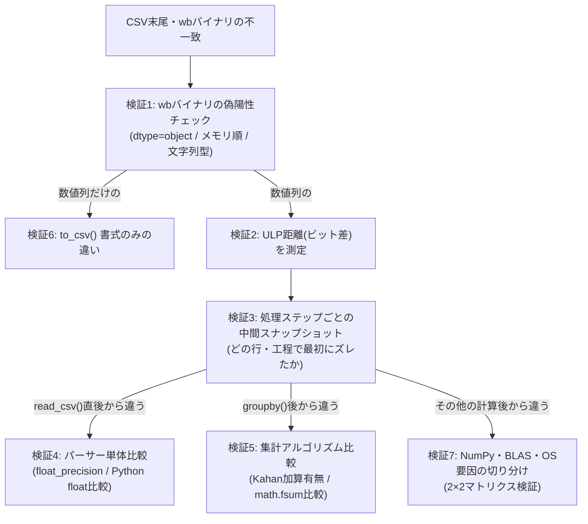

# pandas 2.3.3 → 3.1.1 浮動小数点差異の具体的な検証方法ガイド

> 関連ドキュメント：[pandas 2.3.3 → 3.1.1 浮動小数点の最下位桁差異に関する調査](pandas-2.3.3-to-3.1.1-float-diff.md)

pandas 2.3.3 から 3.1.1 へのアップグレードにおいて「CSV の浮動小数点の最下位桁が異なる」「NumPy 経由のバイナリ（`wb`）書き出しが一致しない」事象の原因と影響範囲を特定するための、実践的な検証アプローチ集です。

---

## 検証の全体フロー（切り分け地図）

いきなり全体を比較すると原因が混ざります。以下の順序で**「見かけの不一致」→「発生工程の特定」→「真因の特定」**へと絞り込みます。



---

## 検証1：`wb` バイナリ不一致の「偽陽性」を潰す

`with open(..., "wb")` で書いたファイルが一致しない場合、**数値自体は 1 bit も違わないのにバイナリだけ不一致になっているケース**が頻繁に発生します。まず以下の確認用コードで「見かけの不一致」を排除します。

### 確認すべき4つの落とし穴
1. **`dtype=object` によるメモリアドレス書き出し**:
   - DataFrame に文字列列と数値列が混在したまま `np.array(df)` を作ると、`dtype` が `object` になります。
   - `object` 配列の `tobytes()` は数値や文字の中身ではなく **Python オブジェクトのメモリアドレス（ポインタ値）** を出力するため、**同じ pandas バージョンでも実行するたびにファイルが変わります**。
2. **pandas 3.0 以降の文字列デフォルト型変更**:
   - 2系では `object` だった文字列列が、3系では `str`（`StringDtype`）になるため、配列変換時の内部表現が変わります。
3. **メモリ配置順（C-order vs F-order）**:
   - DataFrame の作りかたによって、配列が列優先（Fortran-order）と行優先（C-order）のどちらになるか変わることがあります。`tobytes()` 前に `np.ascontiguousarray()` で C-order に統一する必要があります。
4. **DataFrame をそのまま `f.write(arr)` していないか**:
   - `f.write(np.array(df))` はバッファプロトコル経由で生バイト列を書き出すため、上記 1〜3 の影響をモロに受けます。

### 検証用コード：全列の型とバイトレイアウトを診断する

```python
import numpy as np
import pandas as pd

df = pd.read_csv("input.csv")

# 1. 各列の dtype を確認（文字列や混合型が紛れていないか）
print("=== 列ごとの dtype ===")
print(df.dtypes)

# 2. DataFrame 全体を NumPy 化したとき object 型になっていないか確認
arr_all = np.asarray(df)
print(f"\n全体配列: shape={arr_all.shape}, dtype={arr_all.dtype}")
if arr_all.dtype == object:
    print("【警告】dtype=object です！tobytes() / wb書き出しにはメモリアドレスが含まれるため必ず不一致になります。")

# 3. 数値列だけを抽出し、列ごとに float64 / リトルエンディアン / C連続 に固定して保存
numeric_cols = df.select_dtypes(include=[np.number]).columns.tolist()
print("数値列一覧:", numeric_cols)

for col in numeric_cols:
    arr = np.ascontiguousarray(df[col].to_numpy(dtype="<f8"))
    print(f"列 '{col}': size={arr.size}, flags.c_contiguous={arr.flags['C_CONTIGUOUS']}")
```

---

## 検証2：ULP（最下位ビット）距離を測り、誤差の性質を見極める

「末尾1桁が違う」と言われたとき、それが **1 ULP（IEEE 754 float64 の最小単位 1 bit だけの差）** なのか、**数十〜数百万 ULP の差（計算方法・型・丸めミス）** なのかで、取るべき対策が全く変わります。

### 検証用コード：2つの `.bin`（`<f8`）の ULP 距離を集計する

```python
import math
import numpy as np

old = np.fromfile("pandas2_col.bin", dtype="<f8")
new = np.fromfile("pandas3_col.bin", dtype="<f8")
assert old.shape == new.shape, f"件数不一致: {old.shape} vs {new.shape}"

# 1. 特殊値（NaN / Inf / -0.0）の差異を先に分離して数える
both_nan = np.isnan(old) & np.isnan(new)
one_nan = np.isnan(old) ^ np.isnan(new)
both_finite = np.isfinite(old) & np.isfinite(new)

# +0.0 と -0.0 の違い（値は == だが符号ビットが違う）
sign_zero_diff = (old == 0.0) & (new == 0.0) & (np.signbit(old) != np.signbit(new))

# 2. 有限かつ同符号（ゼロ除外）の要素について、ビット表現の整数差 = ULP距離 を計算
same_sign_finite = both_finite & (np.signbit(old) == np.signbit(new))
u_old = old[same_sign_finite].view("<u8")
u_new = new[same_sign_finite].view("<u8")
ulps = np.maximum(u_old, u_new) - np.minimum(u_old, u_new)

# ゼロをまたぐ符号反転があるか
cross_zero = both_finite & (np.signbit(old) != np.signbit(new)) & ~sign_zero_diff

print(f"総件数: {len(old)}")
print(f"完全一致 (ビット単位): {np.sum(old.view('<u8') == new.view('<u8'))}")
print(f"NaN 一方のみ: {np.sum(one_nan)} / 両方NaN: {np.sum(both_nan)}")
print(f"+0.0 / -0.0 の違い: {np.sum(sign_zero_diff)}")
print(f"ゼロを跨いだ符号反転: {np.sum(cross_zero)}")

nonzero_ulps = ulps[ulps > 0]
print(f"同符号で値に差がある件数: {len(nonzero_ulps)}")
if len(nonzero_ulps) > 0:
    print(f"  最小 ULP 差: {nonzero_ulps.min()}")
    print(f"  最大 ULP 差: {nonzero_ulps.max()}")
    print(f"  1 ULP のみ差がある件数: {np.sum(nonzero_ulps == 1)}")
    print(f"  2 ULP 以上差がある件数: {np.sum(nonzero_ulps >= 2)}")

    # 差分サンプルを先頭5件表示
    diff_indices = np.flatnonzero(same_sign_finite)[ulps > 0][:5]
    for idx in diff_indices:
        o_val, n_val = float(old[idx]), float(new[idx])
        print(
            f"  [row={idx}] old={o_val!r} ({o_val.hex()}) "
            f"new={n_val!r} ({n_val.hex()}) "
            f"abs_diff={abs(o_val - n_val):.3e}"
        )
```

### 結果の読み方
- **すべて 1 ULP 差**: 浮動小数点の丸め境界や Kahan 加算の有無による、IEEE 754 上の最小限の差。
- **2〜数 ULP 差が混在**: 複数回の演算（総和・平均・多項式など）の積算順序の違いが蓄積している可能性。
- **数万 ULP 以上・桁が違う**: `float32` 落ち、列・行のズレ、欠損値の扱い、パーサーオプションの相違など、明確な仕様・コード差が存在。

---

## 検証3：パイプラインの「最初の分岐点」を特定する（ステップ別スナップショット）

処理の最初から最後までを通して比較するのではなく、各ステップの直後に共通のダンプ関数を挟んで**「どの行・どの工程で初めてビットが変わったか」**を特定します。

### ステップ別トレーサー（両環境で実行）

```python
import hashlib
import json
import numpy as np
import pandas as pd

def record_stage(df: pd.DataFrame, stage_name: str, report: list):
    """各工程の DataFrame の数値列ビットハッシュと先頭サンプルを記録する"""
    stage_info = {"stage": stage_name, "shape": list(df.shape), "cols": {}}
    for col in df.columns:
        s = df[col]
        col_info = {"dtype": str(s.dtype)}
        if pd.api.types.is_float_dtype(s.dtype) or pd.api.types.is_integer_dtype(s.dtype):
            arr = np.ascontiguousarray(s.to_numpy(dtype="<f8"))
            col_info["sha256_f8"] = hashlib.sha256(arr.tobytes()).hexdigest()
            col_info["sample_hex"] = [float(x).hex() for x in arr[:3]]
        stage_info["cols"][str(col)] = col_info
    report.append(stage_info)

# --- 計測例 ---
trace = []

df = pd.read_csv("input.csv")
record_stage(df, "01_after_read_csv", trace)

df["calc"] = df["a"] * df["b"] + df["c"]
record_stage(df, "02_after_calc", trace)

df_agg = df.groupby("key", as_index=False)["calc"].sum()
record_stage(df_agg, "03_after_groupby_sum", trace)

major = pd.__version__.split(".")[0]
with open(f"trace_pandas{major}.json", "w", encoding="utf-8") as f:
    json.dump(trace, f, indent=2, ensure_ascii=False)
```

### 2環境のトレース結果を突合して最初の分岐点を見つける

```python
import json

with open("trace_pandas2.json", encoding="utf-8") as f:
    t2 = json.load(f)
with open("trace_pandas3.json", encoding="utf-8") as f:
    t3 = json.load(f)

for s2, s3 in zip(t2, t3):
    assert s2["stage"] == s3["stage"]
    diffs = []
    for col, c2 in s2["cols"].items():
        c3 = s3["cols"].get(col, {})
        if c2.get("sha256_f8") != c3.get("sha256_f8"):
            diffs.append((col, c2.get("dtype"), c3.get("dtype"), c2.get("sample_hex"), c3.get("sample_hex")))
    if diffs:
        print(f"[DIFF] 工程 '{s2['stage']}' で最初に不一致を検出:")
        for col, d2, d3, h2, h3 in diffs:
            print(f"  列 '{col}': dtype ({d2} vs {d3})")
            print(f"    2系 sample_hex: {h2}")
            print(f"    3系 sample_hex: {h3}")
        break
    else:
        print(f"[OK]   工程 '{s2['stage']}' は全数値列がビット完全一致")
```

---

## 検証4：`read_csv()` 単体パーサー比較（真値との照合）

工程 `01_after_read_csv` で差が出た場合、pandas 2.3.3 と 3.1.1 のどちらがより正確な IEEE 754 丸め（Python 標準の `float(s)` / `Decimal` からの最近接丸め）をしているかを確認できます。

### 検証用コード：CSV 文字列のパース精度比較

```python
import io
from decimal import Decimal
import pandas as pd

# 実データでズレた文字列や、丸め境界のテスト文字列を並べる
samples = [
    "0.12345678901234567",
    "0.12345678901234566",
    "1.0000000000000001",
    "1.0000000000000003",
    "3.14159265358979323846",
    "1e-16",
    "9007199254740993.0",
    "0.30000000000000004",
]
csv_text = "val\n" + "\n".join(samples) + "\n"

print(f"pandas version: {pd.__version__}")

# 2.3.3 では float_precision の各モードの差を確認できる（3.1.x では非推奨・統一）
for prec in [None, "high", "round_trip"]:
    try:
        df = pd.read_csv(io.StringIO(csv_text), engine="c", float_precision=prec)
    except Exception as e:
        print(f"float_precision={prec!r} error: {e}")
        continue

    print(f"\n--- engine='c', float_precision={prec!r} ---")
    for s, v in zip(samples, df["val"]):
        py_f = float(s)       # Python標準パーサー（David Gay / 正確丸め）
        pd_f = float(v)
        match_py = (pd_f == py_f)
        # Decimal を真値として、どちらが近いかも確認可能
        err_pd = abs(Decimal.from_float(pd_f) - Decimal(s))
        err_py = abs(Decimal.from_float(py_f) - Decimal(s))
        print(f"{s:>24} | pd={pd_f.hex():<20} | ==py_float? {str(match_py):<5} | pd_err<=py_err? {err_pd <= err_py}")
```

**ポイント**: Python の組み込み `float(s)` は、10進文字列を最も近い IEEE 754 `float64` に丸める（correct rounding）ことが仕様として保証されています。3.1.0 の修正（GH #64395）は `read_csv()` の C パーサーをこの正確丸めに近づける方向の変更です。

---

## 検証5：`groupby().sum()` / `mean()`（GH #65103）のピンポイント検証

工程 `03_after_groupby_sum` で差が出た場合の検証です。pandas 3.1.0 から、**浮動小数点列 × ソート済みグループキー**に対する `groupby().sum()/mean()` で Kahan 補償付き加算が使われなくなりました。

### 検証用コード：ソート済みキー集計と `math.fsum` の比較

```python
import math
import numpy as np
import pandas as pd

# 桁落ち・丸め誤差が起きやすい典型データ（大きな値と極小値の混在）
rng = np.random.default_rng(42)
n = 10_000
df = pd.DataFrame({
    "key": np.repeat(["G1", "G2"], n // 2), # ソート済みグループキー
    "val": np.concatenate([
        [1e12] + [1e-4] * (n // 2 - 1),
        rng.uniform(0.0, 1.0, size=n // 2)
    ])
})

# 1. pandas groupby().sum()
pd_sum_sorted = df.groupby("key", sort=True)["val"].sum()
pd_sum_unsorted = df.groupby("key", sort=False)["val"].sum()

# 2. math.fsum() による厳密総和（真値リファレンス）
exact_sum = df.groupby("key")["val"].apply(lambda s: math.fsum(s.tolist()))

print(f"pandas {pd.__version__}")
for k in ["G1", "G2"]:
    v_pd = float(pd_sum_sorted[k])
    v_un = float(pd_sum_unsorted[k])
    v_ex = float(exact_sum[k])
    print(f"Key={k}:")
    print(f"  groupby(sort=True) : {v_pd!r} ({v_pd.hex()})")
    print(f"  groupby(sort=False): {v_un!r} ({v_un.hex()})")
    print(f"  math.fsum (exact)  : {v_ex!r} ({v_ex.hex()})")
```

---

## 検証6：`to_csv()` 出力フォーマッター単体の検証

「内部の `float64` ビット列（`float.hex()`）は 100% 一致しているのに、出力した CSV ファイルの文字列だけ 1 桁違う」場合を切り分けます。

### 検証用コード：同一ビット列を強制注入して `to_csv()` だけ比べる

```python
import struct
import pandas as pd

# まったく同じ64bitビット列（例: 0x1.f9add3746f65ep-4 や 0.1+0.2 など）を直接作る
hex_values = [
    "0x1.f9add3746f65ep-4",
    "0x1.3333333333334p-2",
    "0x1.999999999999ap-4",
    "0x1.fffffffffffffp+0",
]
floats = [float.fromhex(h) for h in hex_values]
df = pd.DataFrame({"val": floats})

print(f"pandas {pd.__version__}")
print("--- デフォルト to_csv ---")
print(df.to_csv(index=False).strip())

print("--- float_format='%.17g' ---")
print(df.to_csv(index=False, float_format="%.17g").strip())

print("--- Python repr() ---")
for x in floats:
    print(repr(x))
```

もしデフォルト `to_csv` だけ 2.3.3 と 3.1.1 で出力文字列が異なるなら、内部数値は完全に一致しており、純粋に **CSV 出力時の10進数文字列化ロジックの差**（例：最短表現桁数の違い）であることが確定します。

---

## 検証7：環境・依存ライブラリ要因の切り分け（2×2 マトリクス検証）

pandas を 2.3.3 → 3.1.1 へ上げたとき、**同時に NumPy（例: 1.26 → 2.x）や BLAS/SIMD ライブラリ、OS/CPU も変わっている**ケースが多々あります。真犯人が pandas なのか NumPy / BLAS なのかを切り分けるには、組み合わせを交差させて比較します。

### 2×2 要因分離テスト表

| テスト環境 | pandas | NumPy | 確認したいこと |
| :--- | :---: | :---: | :--- |
| ① 旧環境（ベースライン） | 2.3.3 | 旧 (例: 1.26) | 基準値 |
| ② NumPyだけ更新（または固定） | 2.3.3 | 新 (例: 2.x) | **②と①が違うなら犯人は NumPy / BLAS** |
| ③ 新環境 | 3.1.1 | 新 (例: 2.x) | **②と③が違うなら犯人は pandas** |

### 依存環境・BLAS設定の差分比較コマンド

両環境で以下を実行し、`diff` で比較します。

```python
import numpy as np
import pandas as pd

pd.show_versions()
print("=== NumPy build config ===")
np.show_config()
```

注目すべき項目：
- `numpy` / `pyarrow` / `python` のバージョン
- `BLAS` / `LAPACK` の実装名（OpenBLAS / MKL / Accelerate）とスレッド数
- CPU の SIMD 命令セット（AVX2 / AVX-512 / NEON 等）

---

## 検証8：業務上の影響度・受け入れ判定テスト

原因が「IEEE 754 上の 1 ULP（約 $10^{-16}$ の相対誤差）以内の自然な丸め差」だと判明した場合、次に決めるべきは**「この差を業務上許容するか、強制一致させるか」**です。

### 自動許容判定スクリプト（テストスイート用）

```python
import numpy as np
import pandas as pd

df_old = pd.read_parquet("output_pandas2.parquet") # 型保持された比較推奨
df_new = pd.read_parquet("output_pandas3.parquet")

# 1. pandas 組み込みの許容誤差比較（末尾1〜数桁の丸め差を許容し、本質的なバグを検出）
pd.testing.assert_frame_equal(
    df_old,
    df_new,
    check_exact=False,
    rtol=1e-14,  # 相対誤差 1e-14 以内を許容（float64 の有効数字 ~15-17桁に対して安全）
    atol=0.0,
)
print("OK: 相対誤差 rtol=1e-14 以内で全項目一致しました。")
```

### 業務要件ごとの判断基準

| 業務要件・テスト方式 | 1 ULP 差への対応指針 |
| :--- | :--- |
| **一般的な分析・集計・機械学習・金額丸め後処理** | **許容可能**。`rtol=1e-14` 等での近似一致テストへ切り替え、3.1.1（より正確なパーサー）へ移行する。 |
| **旧環境の出力ファイルとの SHA-256 / バイト完全一致が契約上必須** | 3.1.1 の既定設定では保証困難。`float_precision` も 3.1 で非推奨・統一されたため、**pandas 2.3.3 + 依存環境をコンテナ等で固定維持**する。 |
| **CSV テキスト回帰テストが末尾 1 桁で落ちる** | 出力書式を `float_format="%.15g"` 等で明示して丸め表示に揃えるか、比較テスト側を数値ベース（`assert_allclose`）に見直す。 |
