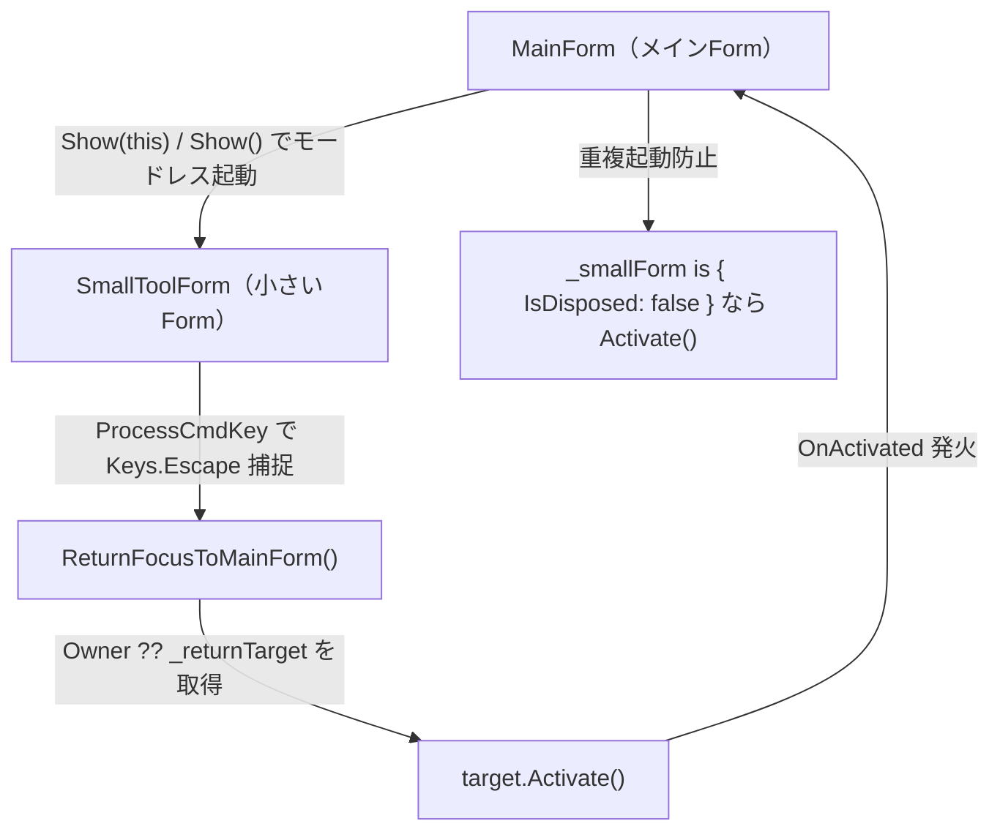
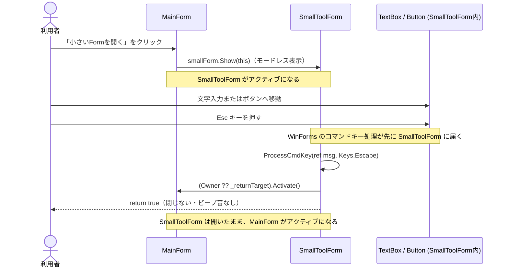

# クラス構成と処理の流れ

## 画面構成とクラス一覧

| クラス | 責務 | ソース |
| --- | --- | --- |
| `Program` | WinForms の初期化と `MainForm` の起動 | [Program.cs](../WinFormsEscFocusReturn/Program.cs) |
| `MainForm` | 「小さいFormを開く」ボタンによるモードレス起動、重複起動防止、`Activated`/`Deactivate` の状態表示 | [MainForm.cs](../WinFormsEscFocusReturn/Forms/MainForm.cs) |
| `SmallToolForm` | `ProcessCmdKey` による `Keys.Escape` の捕捉、閉じずに `Owner ?? _returnTarget` へ `Activate()` を委譲 | [SmallToolForm.cs](../WinFormsEscFocusReturn/Forms/SmallToolForm.cs) |

---

## Esc キー押下時のフォーカス移動シーケンス

---

## 設計上の重要ポイント

### 1. なぜ `CancelButton` を設定しないのか
`Form.CancelButton` にボタンを設定すると、WinForms は Esc キー押下時にそのボタンのクリックとキャンセル動作を実行してフォームを閉じてしまいます。本サンプルでは `SmallToolForm.CancelButton` を未設定（`null`）にし、明示的に「閉じる」ボタンが押されたときだけ `Close()` を呼ぶ設計にしています。

### 2. Visual Studio デザイナーとの互換性
`SmallToolForm` には引数ありコンストラクタ `SmallToolForm(Form? returnTarget)` がありますが、Visual Studio デザイナーでフォームを開けるように、引数なしの `public SmallToolForm() : this(null)` も残しています。

### 3. `ShowDialog()` との比較

| 項目 | `ShowDialog(this)`（モーダル） | `Show(this)`（モードレス） |
| --- | --- | --- |
| 小さいFormが開いている間のメインForm操作 | 不可（フォーカスも移せない） | 可能（`Activate()` で移動できる） |
| Esc キーでメインFormへ戻す方法 | 閉じる必要がある | 閉じずに `Activate()` で移動できる |
| Z オーダー | 常にメインFormより手前 | `Show(this)` なら手前に残る / `Show()` なら後ろに隠れる |
| `Close()` 後の破棄 | 自動では破棄されないため `using` を使う | ユーザーが閉じたときに WinForms が自動で `Dispose()` する |
