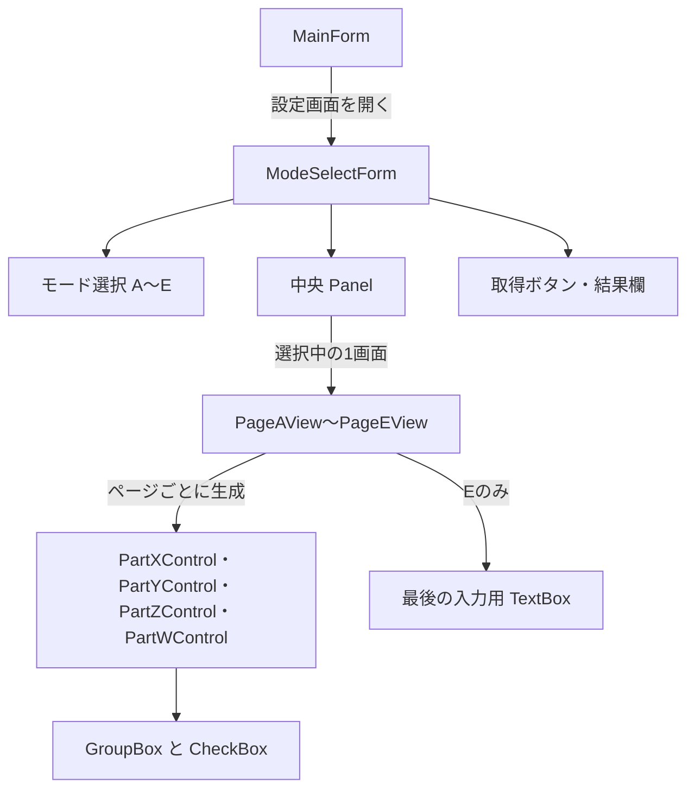
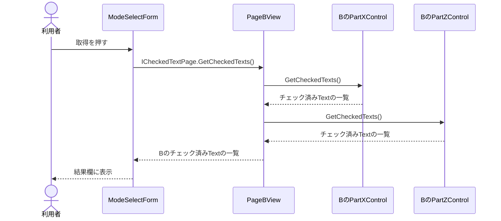
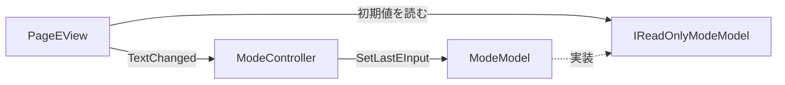

# クラス構成と処理の流れ

## UIの構成

| クラス | 所有するものと責務 | ソース |
| --- | --- | --- |
| `MainForm` | 「設定画面を開く」の操作に応じてモーダルダイアログを生成し、閉じた後に破棄 | [MainForm.cs](../WinFormsReusableParts/Forms/MainForm.cs) |
| `ModeSelectForm` | ModelとControllerをダイアログ単位で生成。ラジオボタン、現在のページ、取得結果欄を管理 | [ModeSelectForm.cs](../WinFormsReusableParts/Forms/ModeSelectForm.cs) |
| `ICheckedTextPage` | 現在のページからチェック済みの表示文字列を取得する契約 | [ICheckedTextPage.cs](../WinFormsReusableParts/Contracts/ICheckedTextPage.cs) |
| `PageAView`〜`PageEView` | ページ固有の部品インスタンスと配置。部品の結果を集約 | [Views/Pages](../WinFormsReusableParts/Views/Pages) |
| `PartXControl`・`PartYControl`・`PartZControl`・`PartWControl` | 部品固有のGroupBox・CheckBox。チェック済み項目のTextを抽出 | [Views/Parts](../WinFormsReusableParts/Views/Parts) |
| `PageEView` | Modelから初期値を読み、TextBoxの変更をControllerに通知 | [PageEView.cs](../WinFormsReusableParts/Views/Pages/PageEView.cs) |
| `ModeController` | Viewから受けた入力をModelの更新に渡す | [ModeController.cs](../WinFormsReusableParts/Controllers/ModeController.cs) |
| `IReadOnlyModeModel`・`ModeModel` | 読み取り用のgetterと、Eの文字列の保存。同値の変更を省く | [Models](../WinFormsReusableParts/Models) |

## チェック済みのTextを取得する

部品の構成を決めるページが、取得対象も決めます。たとえばCはWとXを保持し、W、Xの順に集約します。部品の座標を変更しても、読み出し順はこのコードで決まります。ページを追加するときは、配置した部品をそのページの取得処理にも加えます。

## MVCと状態の寿命

| 状態 | 置き場所 | 保持期間 |
| --- | --- | --- |
| 選択中のモード、取得結果 | `ModeSelectForm` | ダイアログを開いている間。取得結果は次の取得または切り替えまで |
| CheckBoxの選択 | 各部品の `CheckBox.Checked` | そのページを表示している間。戻ると新しいインスタンスの初期値 |
| Eの最新の文字列 | `ModeModel.LastEInput` | ダイアログを開いている間。Eを再生成したときに読み出す |

Viewへ渡すModelの型は、getterだけを持つ `IReadOnlyModeModel` です。入力更新の窓口は `ModeController.ChangeEInput()` で、Modelのsetterは `private` です。更新メソッドの呼び出し箇所をControllerに置くことで、表示のための読み取りと変更依頼をコード上で追えます。

Eの実行時コンストラクターは、引数なしコンストラクターで部品を作り、Modelの値をTextBoxへ入れてから `TextChanged` を接続します。Modelは入力値を保存するだけなので、表示中に別の処理から値が変わる要件が加わった場合は、同期のルールと通知方法を決める必要があります。現在のTextChangedの発行元はページ所有のTextBoxで、ページとともに破棄されます。長寿命のModelやタイマーを発行元にする場合は、購読者の破棄時に購読を解除します。

## 差し替えが成功するまで旧ページを保つ

`ModeSelectForm.ShowPage()` は、同じモードへの通知を無視し、Panelのレイアウトを一時停止してから新しいページを生成・追加します。生成と追加が成功した時点で参照を更新し、旧ページを取り外して `Dispose()` します。その後、取得結果をクリアしてレイアウトを再開します。通常の操作でPanelに残るページは1つです。

生成や追加に失敗したときは、作成できた候補を破棄して選択を元に戻します。旧ページがまだあるときは結果欄にエラーを表示します。初回生成に失敗した場合は例外を呼び出し側に伝えます。`Controls.Remove()` は親子関係を外す操作なので、成功時の旧ページは明示的に `Dispose()` します。
