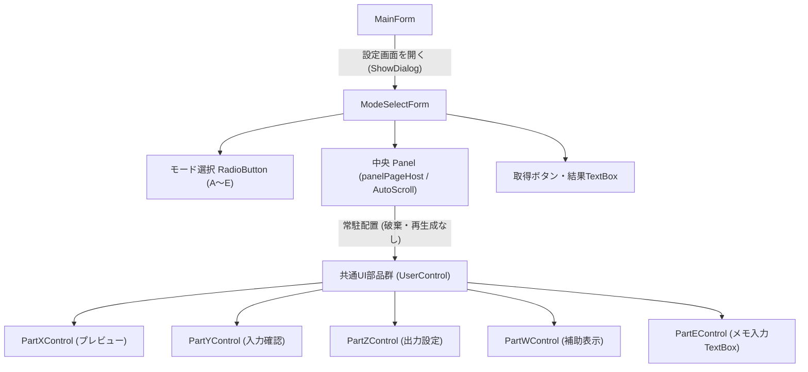
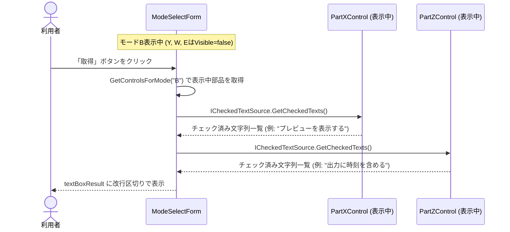
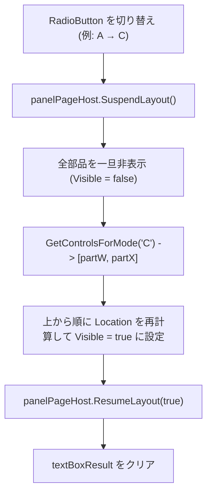

# クラス構成と処理の流れ

## UIの構成

| クラス | 所有するものと責務 | ソース |
| --- | --- | --- |
| `MainForm` | 「設定画面を開く」ボタンでモーダルダイアログを起動し、完了後に破棄 | [MainForm.cs](../WinFormsReusableParts/Forms/MainForm.cs) |
| `ModeSelectForm` | 5つのモード（A〜E）のラジオボタン、部品コンテナ（Panel）、結果表示欄を管理。モードに応じて常駐部品の表示/非表示（`Visible`）と配置順序（`Location`）を切り替える | [ModeSelectForm.cs](../WinFormsReusableParts/Forms/ModeSelectForm.cs) |
| `ICheckedTextSource` | 部品が自身のチェック済み文字列の一覧を返す統一契約インターフェース | [ICheckedTextSource.cs](../WinFormsReusableParts/Contracts/ICheckedTextSource.cs) |
| `PartXControl` | プレビュー関連のCheckBox（「プレビューを表示する」「原寸で表示する」）と取得処理 | [PartXControl.cs](../WinFormsReusableParts/Views/Parts/PartXControl.cs) |
| `PartYControl` | 入力確認CheckBox（「入力値を検証する」）と取得処理 | [PartYControl.cs](../WinFormsReusableParts/Views/Parts/PartYControl.cs) |
| `PartZControl` | 出力設定CheckBox（「出力に時刻を含める」）と取得処理 | [PartZControl.cs](../WinFormsReusableParts/Views/Parts/PartZControl.cs) |
| `PartWControl` | 補助表示CheckBox（「補助ガイドを表示する」）と取得処理 | [PartWControl.cs](../WinFormsReusableParts/Views/Parts/PartWControl.cs) |
| `PartEControl` | メモ入力用TextBox（`textBoxLastEInput`）を保持するUserControl | [PartEControl.cs](../WinFormsReusableParts/Views/Parts/PartEControl.cs) |

---

## チェック済みのTextを取得するフロー

- 親フォーム（`ModeSelectForm`）は、各部品内の個別の CheckBox コントロール名を知る必要がありません。
- `GetControlsForMode(mode)` により、**現在表示されている部品のインスタンスだけ**に `ICheckedTextSource` 経由で問い合わせます。
- 非表示になっている部品（A専用のYや、C専用のWなど）は走査対象に含まれないため、過去にチェックした項目が混入する心配がありません。

---

## モード切り替えとレイアウト再計算の流れ

### 隙間の自動詰めと配置順の制御
- **モード A**: `[partX, partY]`（Xが上、Yが下）
- **モード B**: `[partX, partZ]`（Xが上、Zが下）
- **モード C**: `[partW, partX]`（**Wが上、Xが下**）
- **モード D**: `[partY, partZ]`（Yが上、Zが下）
- **モード E**: `[partE, partX]`（**TextBoxが上、Xが下**）

表示する部品を配列で宣言し、上から順に `Location = new Point(16, top); top += control.Height + 12;` と配置していくため、非表示になった部品の隙間が空くことなく、常に上詰めで美しいレイアウトが保たれます。

---

## ちらつき防止の多層防御

WinForms では、コントロールの追加・削除や背景の再描画時に激しいちらつき（Flicker）が発生しがちです。本サンプルでは以下の3重の対策によって、切り替え時のちらつきを完全に解消しています。

1. **`new` / `Dispose` を行わない（インスタンス常駐）**:
   - 切り替え時にコントロールの破棄や再生成を行わず、`Visible` の切り替えと `Location` の移動のみで完結。
2. **`SuspendLayout()` / `ResumeLayout(true)`**:
   - 配置変更中の途中経過を描画させず、全コントロールの配置完了後に一括でレイアウトを適用。
3. **`WS_EX_COMPOSITED`（合成ダブルバッファリング）**:
   - `ModeSelectForm.CreateParams` でウィンドウスタイル `0x02000000` を追加。OS レベルでフォーム全体およびすべての子コントロールをメモリ上サーフェスに描画してから一括転送するため、背景の白抜けや描画のチラつきが原理的に発生しません。
